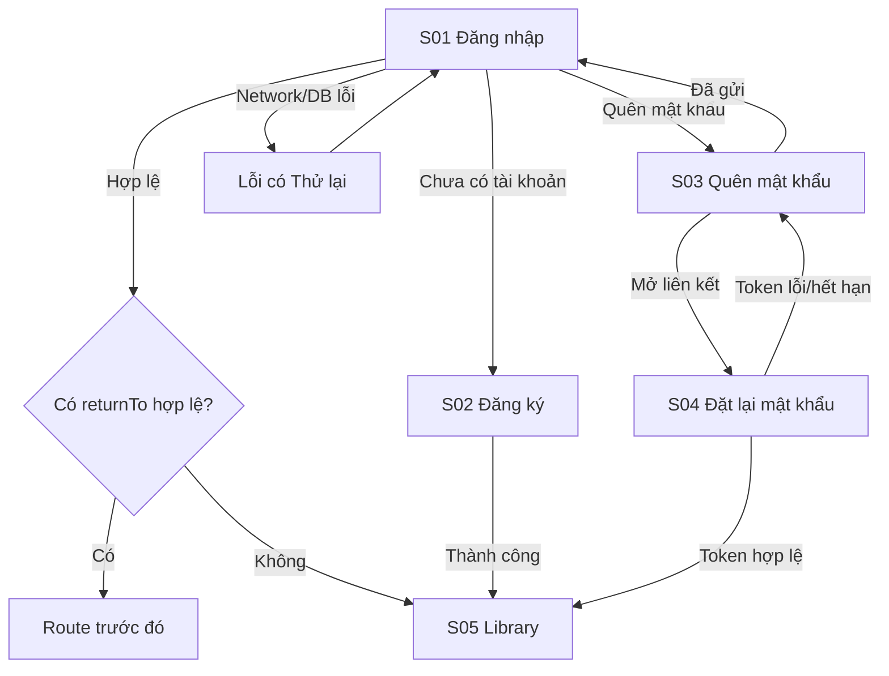
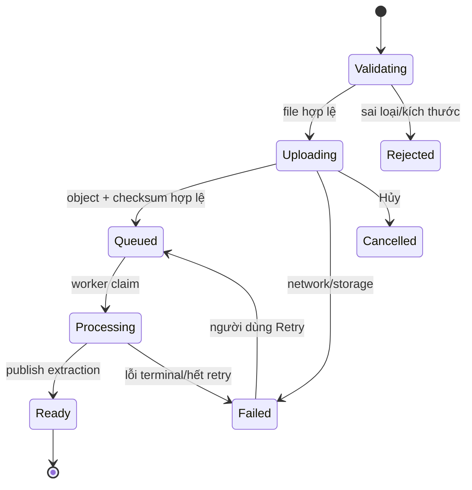
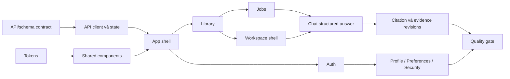

# SourceLens — Tài liệu thiết kế giao diện SaaS

> Phiên bản: 1.0 — 2026-11-20  
> Phạm vi: web app React cho personal workspace; không có payment, team/RBAC hoặc audit kỹ thuật trong giao diện sản phẩm.  
> Nguồn đối chiếu: mã frontend/backend hiện tại, `docs/PLAN/07–15`, `docs/HANDOUT`, design tokens hiện có và hướng dẫn `ui-ux-pro-max`.  
> Trạng thái: đặc tả đích để triển khai. Những chức năng backend chưa hoàn tất được ghi rõ, không được dựng UI giả.

## 1. Phạm vi và nguyên tắc sản phẩm

SourceLens là SaaS đọc và hỏi đáp tài liệu có căn cứ. Người dùng quản lý PDF, mở tài liệu trong workspace, hỏi AI, xem câu trả lời có cấu trúc và nhảy từ citation tới đúng vùng bằng chứng trên trang PDF. Dữ liệu số có nguồn gốc, vị trí và lịch sử sửa; phép tính do chương trình thực hiện thay vì để mô hình tự tính.

### 1.1. Chức năng trong phạm vi giao diện

| Nhóm | Chức năng | Trạng thái sản phẩm đích |
|---|---|---|
| Tài khoản | Đăng ký, đăng nhập, đăng xuất, quên/đặt lại mật khẩu | Bắt buộc |
| Hồ sơ | Xem và sửa tên hiển thị | Bắt buộc |
| Tuỳ chọn | Light/dark/system, ngôn ngữ, phong cách câu trả lời | Bắt buộc |
| Bảo mật | Xem và thu hồi phiên đăng nhập | Có route, chỉ hiển thị khi API hoàn tất |
| Library | Dự án, cây thư mục, tìm kiếm, lọc, sắp xếp, list/grid | Bắt buộc |
| Folder | Tạo, đổi tên, di chuyển, archive | Bắt buộc |
| Document | Upload PDF, đổi tên, di chuyển, archive, restore | Bắt buộc |
| Version | Thay PDF bằng version mới, xem lịch sử version | P1 sau khi API version hoàn tất |
| Workspace | PDF reader, zoom, xoay, phân trang, kéo canvas | Bắt buộc |
| AI chat | Hỏi đáp, trạng thái queued/running/retrying/failed, retry/cancel | Bắt buộc |
| Evidence | Citation, bounding box, dữ liệu số gốc/đã sửa, revision | Bắt buộc |
| Jobs | Upload/extraction/AI jobs, progress stage, lỗi và retry | Bắt buộc |

### 1.2. Ngoài phạm vi

- Payment, subscription, quota trả phí và Lemon Squeezy.
- Organization, team invitation, chia sẻ công khai, RBAC nhiều vai trò.
- Sửa trực tiếp bytes PDF; thay file luôn tạo `document_version` mới.
- Raw prompt, request/response payload, trace nội bộ và audit drawer trên product UI.
- Redis trong luồng giao diện; UI chỉ phụ thuộc contract job, không phụ thuộc công nghệ queue.

### 1.3. Thuật ngữ chuẩn

| Thuật ngữ UI | Nghĩa | Không dùng thay thế |
|---|---|---|
| Dự án | Không gian cấp cao chứa cây thư mục và tài liệu | Workspace, tenant |
| Thư mục | Node trong cây của một dự án | Phiên |
| Tài liệu | PDF logic, có thể có nhiều version | File khi nói về identity |
| Phiên phân tích | Hội thoại gắn với tài liệu/version và lịch sử câu hỏi | Dự án |
| Workspace đọc | Màn hình PDF + chat + citation | Test lab, audit flow |
| Nguồn dẫn | Liên kết từ câu trả lời tới trang/vùng PDF | Link chung chung |
| Bằng chứng | Vùng văn bản/bảng/biểu đồ hỗ trợ một claim | Trace |
| Tác vụ | Công việc nền như extraction hoặc AI answer | Request |
| Archive | Ẩn có thể khôi phục | Xóa vĩnh viễn |
| Xóa vĩnh viễn | Purge sau xác nhận và dependency check | Archive |

## 2. Kiến trúc thông tin và điều hướng

### 2.1. Cấu trúc thông tin

```text
SourceLens
├── Khu vực công khai
│   ├── Đăng nhập
│   ├── Đăng ký
│   ├── Quên mật khẩu
│   └── Đặt lại mật khẩu
└── Khu vực đã đăng nhập
    ├── Library
    │   ├── Dự án hiện tại
    │   ├── Cây thư mục
    │   ├── Danh sách tài liệu
    │   ├── Upload tray
    │   └── Job Center
    ├── Workspace đọc
    │   ├── Danh sách phiên/tài liệu gần đây
    │   ├── PDF reader
    │   ├── Hội thoại AI
    │   ├── Citation Inspector
    │   └── Evidence Revision panel
    └── Cài đặt
        ├── Hồ sơ
        ├── Tuỳ chọn
        └── Bảo mật
```

### 2.2. Điều hướng toàn cục

- Desktop: sidebar toàn cục rộng `248px`, gồm logo, `Library`, `Workspace gần đây`, `Cài đặt`; cuối sidebar có profile menu. Header nội dung cao `64px` chứa breadcrumb, tìm kiếm theo ngữ cảnh, Job Center và CTA chính.
- Workspace đọc trên desktop ≥1280px dùng chế độ tập trung: sidebar toàn cục thu còn `72px`; header vẫn có nút quay lại Library, tên tài liệu, trạng thái lưu và profile menu.
- Tablet: sidebar thu thành rail `72px`; nhãn hiện qua tooltip. Workspace chỉ hiển thị PDF hoặc Chat theo tab, không ép ba cột.
- Mobile: bottom navigation gồm `Tài liệu`, `Workspace`, `Cài đặt`; header cao `56px`, nút Back dùng lịch sử hợp lệ hoặc đích cha rõ ràng.
- Job Center là panel toàn cục mở từ icon tác vụ; không phải route riêng trong P0.

### 2.3. Điều hướng trong khu vực

| Khu vực | Điều hướng cục bộ | Quy tắc |
|---|---|---|
| Library | Project switcher, folder tree, breadcrumb, search/filter/sort | Folder tree và breadcrumb luôn đồng bộ; browser Back khôi phục folder/query |
| Workspace | Nút về Library, danh sách phiên, tab PDF/Chat trên tablet/mobile | Citation không đổi route; cập nhật `page` và `evidence` trong query string |
| Settings | Subnav Hồ sơ/Tuỳ chọn/Bảo mật | Mỗi tab là route vì nhiệm vụ và form khác nhau |
| Auth | Link giữa login/register/forgot | Giữ `returnTo` hợp lệ, không giữ password |

### 2.4. Quy tắc đặt tên

- Menu dùng danh từ ngắn: `Tài liệu`, `Cài đặt`; CTA dùng động từ: `Tải PDF`, `Tạo thư mục`, `Gửi câu hỏi`.
- Tiêu đề trang mô tả đối tượng: `Tài liệu của bạn`, `Hồ sơ cá nhân`.
- Dialog dùng hành động + đối tượng: `Đổi tên tài liệu`, `Archive thư mục`; destructive confirmation dùng câu hỏi: `Xóa vĩnh viễn tài liệu này?`.
- Breadcrumb không lặp tiêu đề trang và tối đa 4 cấp hiển thị; cấp giữa collapse thành menu `…`.
- Không dùng thuật ngữ hạ tầng như PostgreSQL, R2, worker, queue trong nhãn người dùng. Dùng `Đã lưu`, `Đang xử lý`, `Đang chờ`.

### 2.5. Biết vị trí và quay lại

- Item điều hướng hiện tại có icon + nền selected + `aria-current="page"`; không chỉ đổi màu chữ.
- Header hiển thị breadcrumb trên Library/Settings; Workspace hiển thị `Library / Tên tài liệu` và nút `Quay lại Library`.
- Browser Back phải hoạt động với route, folder, filter và document selection. Modal/panel đóng trước khi rời route.
- Khi mở Workspace từ Library, Back quay lại đúng project/folder/filter/scroll trước đó.
- Sau login, điều hướng tới `returnTo` nếu cùng origin và thuộc `/app`; nếu không tới `/app`.

### 2.6. Trạng thái phải giữ

| Trạng thái | Nơi giữ | Thời hạn | Không được giữ |
|---|---|---|---|
| User, preferences | Query cache + server | Qua refresh/session | Token raw |
| Theme bootstrap | local storage + DB sau login | Qua refresh | Password |
| Project/folder/filter/sort/view | URL query + session state | Back/Forward, refresh | Raw API response |
| Library selection | URL hoặc scoped state | Khi đổi list/grid; xóa khi đổi project | Selection resource đã archive |
| Workspace page/zoom/rotation | URL cho page; session state cho zoom/rotation | Khi qua Chat/PDF tab | Canvas bitmap |
| Draft câu hỏi | Scoped state theo session/document | Khi đổi panel; cảnh báo nếu rời | Draft sau logout |
| Chat messages/jobs | Server/query cache | Qua refresh/reconnect | Fake completed state |
| Modal/panel đang mở | Route state hoặc local state | Đóng khi Back/Escape | Sau logout |
| Scroll Library/chat | Navigation state | Khi quay lại | Sau đổi project/session |

### 2.7. Danh mục scene

| ID | Tên scene | Người dùng | Mục đích | Điểm vào | Điểm ra | Route dự kiến |
|---|---|---|---|---|---|---|
| S01 | Đăng nhập | Khách | Mở phiên an toàn | Route công khai, session hết hạn | Library/returnTo, Quên mật khẩu, Đăng ký | `/login` |
| S02 | Đăng ký | Khách | Tạo tài khoản personal workspace | Link từ Login | Library, Login | `/register` |
| S03 | Quên mật khẩu | Khách | Yêu cầu liên kết reset | Link từ Login | Trạng thái đã gửi, Login | `/forgot-password` |
| S04 | Đặt lại mật khẩu | Khách có token | Đặt mật khẩu mới | Link email/dev token | Library hoặc token lỗi | `/reset-password?token=…` |
| S05 | Library | Người đã đăng nhập | Quản lý dự án, thư mục, tài liệu | `/app`, sau login, quay lại từ Workspace | Workspace, Settings, logout | `/app/library/:projectId` |
| S06 | Workspace đọc | Người sở hữu tài liệu | Đọc PDF, hỏi AI, kiểm tra citation/evidence | Mở tài liệu/phiên từ Library | Library, Settings | `/app/workspace/:sessionId/:documentId` |
| S07 | Cài đặt — Hồ sơ | Người đã đăng nhập | Xem/sửa tên và email | Profile menu, Settings nav | Preferences, Security, Library | `/app/settings/profile` |
| S08 | Cài đặt — Tuỳ chọn | Người đã đăng nhập | Theme, locale, answer style | Settings nav, theme shortcut | Profile, Security, Library | `/app/settings/preferences` |
| S09 | Cài đặt — Bảo mật | Người đã đăng nhập | Quản lý password/session | Settings nav, profile menu | Login sau revoke self, Settings | `/app/settings/security` |
| S10 | Không tìm thấy/không được phép | Mọi người | Phục hồi khi route/resource không hợp lệ | 404/403/owner mismatch | Library, Login, Back | `*` hoặc state của route |

### 2.8. Phân loại surface

| Loại | Surface | Lý do không tách scene |
|---|---|---|
| Tab | PDF / Chat trên tablet-mobile | Cùng mục tiêu của S06, chỉ đổi vùng ưu tiên |
| Tab | List / Grid, Active / Archived trong S05 | Cùng tập dữ liệu và mục tiêu quản lý |
| Panel | Job Center, Upload tray | Theo dõi xuyên scene, không tạo nhiệm vụ độc lập |
| Panel | Citation Inspector, Evidence Revision | Ngữ cảnh của tài liệu/câu trả lời hiện tại |
| Modal | Tạo/đổi tên/di chuyển/archive folder/document | Tác vụ ngắn, quay lại đúng context |
| Modal | Upload/Replace PDF | Command theo ngữ cảnh; progress chuyển sang tray |
| Menu | Profile, item overflow, bulk actions | Progressive disclosure cho hành động phụ |
| Trạng thái | Loading, empty, error, offline, processing, conflict | Không thay đổi mục tiêu chính của scene |

## 3. Các luồng sử dụng chính

### 3.1. F01 — Đăng ký/đăng nhập và khôi phục phiên

**Bắt đầu:** người dùng chưa có session hoặc session hết hạn.  
**Kết quả mong muốn:** vào đúng màn trước đó mà không lộ token hay mất context hợp lệ.

1. Mở S01; hệ thống kiểm tra `/auth/me` bằng skeleton, không flash workspace.
2. Người dùng nhập email/password; lỗi trường hiển thị dưới trường, lỗi credential hiển thị tại form.
3. Submit khóa nút, giữ giá trị email, đổi nhãn thành `Đang đăng nhập…`.
4. Thành công: hydrate user/preferences, redirect `returnTo` hoặc S05.
5. Nếu chưa có tài khoản, tới S02; đăng ký thành công đi S05.
6. Nếu quên mật khẩu, tới S03; response luôn hiển thị cùng một thông báo không tiết lộ email tồn tại.
7. Link hợp lệ mở S04; thành công revoke session cũ, tạo session mới và tới S05.



### 3.2. F02 — Tạo thư mục, upload PDF và chờ extraction

**Bắt đầu:** người dùng đang ở S05 trong một dự án.  
**Kết quả mong muốn:** PDF được lưu bền, xuất hiện đúng thư mục và chuyển từ upload sang ready minh bạch.

1. Chọn `Tạo thư mục` hoặc `Tải PDF` ở S05.
2. Tạo thư mục: modal validate tên/parent; thành công cập nhật tree và focus folder mới.
3. Upload: chọn/drag file; client kiểm tra `.pdf`, tối đa 100 MiB nhưng server vẫn là nguồn xác nhận.
4. Item optimistic chỉ hiện khi upload intent đã được server chấp nhận; Upload tray hiển thị byte progress.
5. Upload hoàn tất: item chuyển `Đang chờ`; job extraction xuất hiện ở Job Center.
6. Worker chạy: item `Đang xử lý — Đọc văn bản/bảng/biểu đồ` theo stage thật, không phần trăm giả.
7. Thành công: item `Sẵn sàng`, CTA `Mở workspace`.
8. Lỗi terminal: item `Xử lý thất bại`, hiển thị nguyên nhân thân thiện, `Thử lại` và correlation ID có thể copy.
9. Hủy upload đang truyền: xác nhận nhẹ, xóa upload intent; cancel extraction chỉ khi job cho phép.



### 3.3. F03 — Mở tài liệu, hỏi AI và kiểm tra citation

**Bắt đầu:** document version ở trạng thái ready trong S05.  
**Kết quả:** câu trả lời có cấu trúc, xuất hiện đúng thứ tự và mỗi claim quan trọng nhảy tới bằng chứng.

1. Mở document → S06; PDF page 1 và conversation gần nhất tải song song.
2. Nhập câu hỏi; `Enter` gửi, `Shift+Enter` xuống dòng.
3. UI lập tức append user message + assistant placeholder tại đúng vị trí, cuộn cuối một lần.
4. API persist messages/job rồi trả; placeholder hiển thị `Đang hiểu câu hỏi`, sau đó stage an toàn.
5. Thành công: cùng placeholder đổi thành answer blocks; không append bản sao xuống cuối.
6. Công thức hiển thị biểu thức, dữ liệu thay thế, kết quả calculator và đơn vị.
7. Bấm citation: PDF chuyển đúng trang; Evidence Layer vẽ bbox theo normalized coordinates; Citation Inspector hiển thị quote, phương pháp đọc và confidence.
8. Nếu câu hỏi mơ hồ: assistant hiển thị clarification choices; chọn một cách hiểu gửi lại kế hoạch đã xác định.
9. Nếu thiếu dữ liệu/sai đơn vị/chia 0: hiển thị controlled result, không dựng số.
10. Nếu job fail: placeholder giữ vị trí với `Thử lại`; retry dùng cùng message context và idempotency policy.

### 3.4. F04 — Sửa dữ liệu số và cập nhật câu trả lời

**Bắt đầu:** từ citation hoặc nút `Dữ liệu` trong S06.  
**Kết quả:** lưu giá trị cũ/mới/lý do, đánh dấu answer bị ảnh hưởng và tính lại an toàn.

1. Mở Evidence Revision panel; chọn số theo page/source/method.
2. Panel hiển thị original value, current value, revision history, bbox và `đọc từ nhãn`/`ước lượng theo trục`.
3. Chọn `Sửa`; nhập giá trị và lý do bắt buộc.
4. Submit kèm `expected_revision_id`; khi 409, hiển thị current revision và cho `Tải lại`, không ghi đè.
5. Thành công: thêm revision, giữ original bất biến, đánh dấu answers liên quan `Cần cập nhật`.
6. Người dùng chọn `Tính lại`; tạo job deterministic/answer mới với revision fence.
7. Job thành công cập nhật answer revision tại chỗ; citation vẫn gắn version/evidence chính xác.

### 3.5. F05 — CRUD, archive/restore và thay version tài liệu

**Bắt đầu:** S05 hoặc sidebar S06.  
**Kết quả:** metadata thay đổi nhất quán, thao tác nguy hiểm có khả năng phục hồi.

- Rename folder/document: dialog prefill, submit theo expected version, conflict 409 có lựa chọn tải lại.
- Move: dialog cây thư mục, cấm descendant/self-parent; thành công giữ selection và cập nhật breadcrumb.
- Archive: confirmation mô tả ảnh hưởng; item biến khỏi Active và toast có `Hoàn tác` trong 8 giây.
- Restore: từ tab Archived, trả về folder gần nhất còn tồn tại hoặc root và thông báo rõ.
- Replace PDF: upload tạo version mới; version hiện hành chỉ đổi theo policy sau extraction ready; chat/citation cũ vẫn gắn version cũ.
- Purge: chỉ có trong Archived/version history khi API xác nhận đủ điều kiện; confirmation yêu cầu gõ tên tài liệu. Đây là thao tác khác Archive.

### 3.6. F06 — Theo dõi, retry và cancel tác vụ

1. Badge tác vụ toàn cục hiển thị tổng active jobs; không dùng badge hạ tầng.
2. Mở Job Center panel; nhóm `Đang chạy`, `Cần xử lý`, `Đã xong gần đây`.
3. Job queued/running có stage, thời gian bắt đầu, resource và nút cancel khi API cho phép.
4. Failed có error message, correlation ID và `Thử lại` nếu retryable.
5. Retry tạo attempt mới nhưng item UI liên kết cùng mục tiêu; không nhân đôi document/message.
6. Mất kết nối: panel giữ snapshot, banner `Đang kết nối lại`; reconnect refetch và reconcile theo server.

### 3.7. F07 — Sửa hồ sơ, tuỳ chọn và đăng xuất

1. Profile menu mở từ shell; chọn S07/S08/S09 hoặc `Đăng xuất`.
2. S07 sửa display name; lưu thành công cập nhật avatar/header ngay.
3. S08 đổi theme preview tức thời; save DB, rollback và báo lỗi nếu thất bại.
4. S09 revoke session khác tại chỗ; revoke session hiện tại yêu cầu xác nhận rồi về S01.
5. Đăng xuất từ menu revoke cookie session, clear cache/draft nhạy cảm và về S01.

## 4. Quy chuẩn giao diện dùng chung

### 4.1. Hướng thẩm mỹ

- B2B document intelligence: tin cậy, dày thông tin nhưng có thứ bậc, không dùng robot/gradient tím AI đại trà.
- Plus Jakarta Sans cho sản phẩm; `ui-monospace` chỉ cho ID/correlation/formula.
- Light là mặc định; dark là bộ token riêng. PDF canvas không đảo màu.
- Micro-interaction 150–200ms cho hover/focus/panel; không scale card gây dịch layout; tuân thủ `prefers-reduced-motion`.

### 4.2. Color tokens

| Token | Light | Dark | Vai trò |
|---|---:|---:|---|
| `--color-bg-canvas` | `#F8FAFC` | `#0B1220` | Nền app |
| `--color-bg-surface` | `#FFFFFF` | `#111827` | Panel/card |
| `--color-bg-subtle` | `#F1F5F9` | `#172033` | Hover/section phụ |
| `--color-text-primary` | `#020617` | `#F8FAFC` | Tiêu đề/body chính |
| `--color-text-secondary` | `#475569` | `#CBD5E1` | Mô tả |
| `--color-text-tertiary` | `#64748B` | `#94A3B8` | Metadata, phải đạt contrast phù hợp cỡ chữ |
| `--color-border` | `#E2E8F0` | `#334155` | Viền thường |
| `--color-border-strong` | `#CBD5E1` | `#475569` | Control/selected |
| `--color-brand` | `#0F172A` | `#E2E8F0` | Logo, shell |
| `--color-action` | `#0369A1` | `#38BDF8` | CTA, link, focus |
| `--color-action-hover` | `#075985` | `#7DD3FC` | Hover action |
| `--color-evidence` | `#A16207` | `#FACC15` | Citation/bbox |
| `--color-evidence-bg` | `#FEF9C3` | `rgba(250,204,21,.14)` | Evidence highlight |
| `--color-success` | `#047857` | `#34D399` | Thành công/ready |
| `--color-warning` | `#B45309` | `#FBBF24` | Chờ/conflict |
| `--color-danger` | `#B42318` | `#FB7185` | Lỗi/destructive |
| `--color-info` | `#1D4ED8` | `#60A5FA` | Job/information |

Status luôn có icon/label ngoài màu. Focus ring dùng `0 0 0 3px rgba(3,105,161,.24)` và không bị `overflow:hidden` cắt.

### 4.3. Typography tokens

| Token | Size/line-height | Weight | Dùng cho |
|---|---|---|---|
| `--text-xs` | `12/16px` | 400–600 | Metadata, badge; không nhỏ hơn 12px |
| `--text-sm` | `14/20px` | 400–600 | Body compact, control |
| `--text-md` | `16/24px` | 400–600 | Body/form |
| `--text-lg` | `18/26px` | 600 | Section heading |
| `--text-xl` | `20/28px` | 650 | Panel/page heading nhỏ |
| `--text-2xl` | `24/32px` | 650–700 | Page title |
| `--text-3xl` | `32/40px` | 700 | Auth headline desktop |

- Answer body dùng `16/26px`; bảng dùng `13/20px`; công thức dùng font mono `14/22px`.
- Dòng văn bản tối đa `72ch`; tên file ellipsis một dòng, tooltip hiển thị đầy đủ.
- Không dùng uppercase cho đoạn dài; eyebrow tối đa 12 ký tự, tracking `0.08em`.

### 4.4. Spacing, radius, border và shadow

| Nhóm | Token và giá trị |
|---|---|
| Spacing | `--space-1:4px`, `2:8px`, `3:12px`, `4:16px`, `5:20px`, `6:24px`, `8:32px`, `10:40px`, `12:48px` |
| Radius | `--radius-xs:6px`, `sm:8px`, `md:10px`, `lg:14px`, `xl:18px`, `pill:999px` |
| Border | `--border-width:1px`; selected có border strong + background, không tăng width |
| Shadow | `sm:0 1px 2px rgba(15,23,42,.06)`, `md:0 8px 24px rgba(15,23,42,.10)`, `lg:0 20px 50px rgba(15,23,42,.16)` |

### 4.5. Kích thước và hệ layout

| Vùng | Desktop ≥1280 | Tablet 768–1279 | Mobile <768 |
|---|---|---|---|
| Global header | 64px | 60px | 56px |
| Global sidebar | 248px; Workspace focus 72px | 72px rail | Bottom nav 64px |
| Library content | max 1440px, padding 24–32px | padding 20px | padding 16px |
| Workspace | rail 72px + reader min 560px + chat 420px | rail + một panel chính; Chat/PDF tabs | một panel, full width |
| Inspector | 360–420px drawer | 360px overlay | full-screen sheet |
| Modal | 400–640px theo nội dung | max calc(100%-40px) | bottom sheet hoặc calc(100%-24px) |

Breakpoints chuẩn: `375`, `768`, `1024`, `1280`, `1440px`. Không tạo horizontal scroll toàn trang; bảng rộng dùng container `overflow-x:auto` có gradient báo còn nội dung.

### 4.6. Icon và hình ảnh

- Một bộ Lucide/Heroicons outline, viewBox 24, stroke 1.75–2; kích thước 16 control, 20 navigation, 24 empty state.
- Icon-only button bắt buộc có tooltip và `aria-label`; vùng bấm tối thiểu 40×40 desktop, 44×44 touch.
- Không dùng emoji cho chức năng. PNG/WebP chỉ dùng illustration trạng thái; SVG cho icon/brand.
- PDF thumbnail dùng ảnh trang thật khi sẵn sàng; loading dùng skeleton đúng tỷ lệ A4, không placeholder ngẫu nhiên.

### 4.7. Trạng thái tương tác chung

| Trạng thái | Quy chuẩn |
|---|---|
| Hover | Đổi background/border/color trong 150ms; không scale gây layout shift |
| Focus | Ring 3px rõ ràng, focus-visible; không xóa outline nếu chưa thay thế |
| Active | Nền đậm hơn hover; button có cảm giác nhấn bằng shadow giảm, không di chuyển >1px |
| Selected | Icon/check + border/background + `aria-selected`; không chỉ màu |
| Disabled | Giảm opacity tối đa 50%, giữ đọc được; tooltip giải thích nếu điều kiện nghiệp vụ |
| Loading | >300ms phải có spinner/skeleton; button giữ width, disabled chống double submit |
| Success | Cập nhật tại chỗ + toast ngắn; focus tới kết quả khi cần |
| Error | Inline gần nguồn lỗi + `role=alert`; toast chỉ bổ sung, luôn có cách recovery |

### 4.8. Component dùng chung

| Component | Variant cần có | Quy tắc |
|---|---|---|
| `Button` | primary, secondary, ghost, danger; sm/md/lg; loading | Một primary CTA mỗi vùng |
| `IconButton` | neutral, danger; tooltip | Tối thiểu 40×40, aria-label |
| `Input/Textarea` | default, error, success, disabled | Label thật, help/error liên kết `aria-describedby` |
| `Select/Combobox` | single, searchable | Keyboard đầy đủ, không tự đóng khi lỗi |
| `Checkbox` | default, indeterminate | Dùng cho bulk selection |
| `Tabs` | underline desktop, segmented compact | `aria-controls`, arrow keys |
| `Menu` | account, item, bulk | Escape đóng; focus trả về trigger |
| `Dialog` | form, confirm, destructive | Focus trap; tiêu đề/mô tả; Escape trừ khi đang commit |
| `Drawer/Sheet` | right, bottom/full-screen mobile | URL/local state nhất quán; Back đóng |
| `Toast` | success, error, info; optional action | Không chứa lỗi form duy nhất; 5–8s |
| `Badge` | neutral, success, warning, danger, info | Icon/label; không dùng badge cho câu dài |
| `Skeleton` | row, card, A4, message | Khớp layout cuối, tránh shift |
| `EmptyState` | first-use, no-results, archived | Một CTA rõ; copy theo ngữ cảnh |
| `ErrorState` | inline, panel, page | Message + retry/back/help/correlation |
| `FileItem` | list, grid, selected, processing | Cùng command handler cho menu/keyboard |
| `JobStatus` | queued/running/retrying/failed/succeeded | Stage thật, elapsed, retry/cancel có điều kiện |
| `AnswerBlock` | paragraph, list, table, formula, claim, warning | Không render raw markdown/html thiếu kiểm soát |
| `EvidenceLink` | page, bbox, quote | Mở đúng trang và biểu diễn selected state |

## 5. Thiết kế chi tiết từng scene

## S01 — Đăng nhập

### 5.1. Định danh và mục đích

- **Route:** `/login`; public-only. User đã xác thực được redirect theo `returnTo` hoặc S05.
- **Điều kiện mở:** không có cookie session hợp lệ, session hết hạn, hoặc người dùng đăng xuất.
- **Nhiệm vụ chính:** nhập thông tin, biết rõ kết quả và vào lại đúng context hợp lệ.

### 5.2. Bố cục

- Desktop: split layout `minmax(420px, 46%) / 1fr`. Trái là form rộng tối đa `440px`, căn giữa; phải là product proof với screenshot/illustration tài liệu có citation, không phải marketing carousel.
- Header tối giản nằm trên form: logo + tên SourceLens; không có global navigation.
- Mobile/tablet dọc: chỉ form, product proof chuyển thành ba dòng lợi ích phía dưới; toàn trang cuộn khi bàn phím mở.
- Thứ tự thị giác: tiêu đề → mô tả → form → CTA → link phụ → cam kết bảo mật.

### 5.3. Thành phần hiển thị

| Thành phần | Nội dung/nhãn mẫu | Vị trí | Dữ liệu hiển thị | Hành vi |
|---|---|---|---|---|
| Logo | SourceLens | đầu card | static | về `/login` |
| Heading | `Đăng nhập vào workspace của bạn` | trên form | static | h1 duy nhất |
| Email | `Email` | form | form state | autocomplete email |
| Password | `Mật khẩu` | form | không persist | show/hide bằng icon |
| Forgot link | `Quên mật khẩu?` | cùng hàng label password | `returnTo` an toàn | tới S03 |
| Submit | `Đăng nhập` | cuối form | busy/error | gọi login; loading giữ width |
| Register link | `Chưa có tài khoản? Tạo tài khoản` | dưới CTA | returnTo | tới S02 |
| Security note | `Phiên được bảo vệ bằng cookie HttpOnly` | cuối card | static | tooltip giải thích ngắn |
| Product proof | `Hỏi tài liệu với nguồn dẫn chính xác` | panel phải | asset + 3 lợi ích | decorative image có alt phù hợp hoặc aria-hidden |

### 5.4. Thao tác

- **Đăng nhập:** chỉ cho phép khi email/password hợp lệ phía client; append không gian không tự sửa password. Phản hồi ngay bằng loading; thành công redirect; 401 giữ email, clear password tùy policy và focus lỗi credential.
- **Hiện mật khẩu:** chỉ đổi type, không đổi giá trị; label thay đổi `Hiện/Ẩn mật khẩu`.
- **Chuyển đăng ký/quên mật khẩu:** giữ email và `returnTo`, không giữ password.
- **Session hết hạn trong app:** về S01 với banner `Phiên đã hết hạn. Đăng nhập lại để tiếp tục`; không toast lẻ trong workspace.

### 5.5. Biểu mẫu và kiểm tra dữ liệu

| Tên | Loại điều khiển | Bắt buộc | Mặc định | Ràng buộc | Thông báo lỗi |
|---|---|---:|---|---|---|
| Email | input email | Có | email đã nhập trước đó nếu an toàn | trim, lowercase server, 3–320 ký tự, dạng email | `Nhập email hợp lệ.` |
| Mật khẩu | password + reveal | Có | rỗng | 1–256 ký tự ở login | `Nhập mật khẩu.` |

- Validate khi blur và submit; lỗi server credential đặt trong form alert phía trên CTA nhưng focus tới alert.
- Enter submit; submit lỗi không reset toàn form. Không có cảnh báo unsaved khi rời login.

### 5.6. Các trạng thái

| Trạng thái | Hiển thị và hành động |
|---|---|
| Kiểm tra session | Skeleton card + `Đang kiểm tra phiên…`; không render form trong tích tắc |
| Sẵn sàng | Form đầy đủ, CTA enabled khi hợp lệ |
| Đang gửi | Nút `Đang đăng nhập…` + spinner; fields readonly, link phụ vẫn không điều hướng ngoài ý muốn |
| Sai credential | Alert `Email hoặc mật khẩu không đúng`; không tiết lộ email tồn tại; `Thử lại` bằng submit |
| 429 | `Bạn đã thử quá nhiều lần. Thử lại sau {n} phút.`; CTA disabled theo retry-after |
| Mất kết nối | Inline error `Không thể kết nối`; nút `Thử lại`, giữ email |
| Backend auth unavailable | Page error có retry; không tự chuyển demo mode |

### 5.7. Responsive và khả năng tiếp cận

- Focus order: logo → email → password → reveal → forgot → submit → register.
- Mỗi input có label; alert dùng `role=alert`; focus ring rõ trên cả light/dark.
- Mobile input font ≥16px để tránh auto zoom; tap target ≥44px.
- Product proof ẩn bằng CSS ở <768 nhưng không làm mất nội dung thiết yếu.

### 5.8. Tiêu chí nghiệm thu

- Không flash S05 trước khi `/auth/me` kết luận.
- Submit một lần tạo tối đa một request và không lưu token vào localStorage.
- 401 hiển thị đúng form, giữ email, password không lộ.
- `returnTo` ngoài origin hoặc ngoài `/app` bị bỏ qua.
- Tab/Enter/Shift+Tab hoạt động, focus không rơi vào vùng ẩn.
- Scene đúng ở 375, 768, 1024 và 1440px; không scroll ngang.

## S02 — Đăng ký

### 5.1. Định danh và mục đích

- **Route:** `/register`; public-only.
- **Điều kiện:** auth registration được bật, user chưa đăng nhập.
- **Nhiệm vụ:** tạo personal workspace bằng email/password và vào Library.

### 5.2. Bố cục

- Dùng cùng AuthShell với S01 để giữ nhận diện; form rộng `440px`.
- Product proof đổi copy sang `Từ PDF tới câu trả lời có căn cứ trong một workspace`.
- Không thêm stepper cho ba trường; tránh onboarding phức tạp.

### 5.3. Thành phần hiển thị

| Thành phần | Nội dung/nhãn mẫu | Vị trí | Dữ liệu | Hành vi |
|---|---|---|---|---|
| Heading | `Tạo workspace SourceLens` | trên form | static | h1 |
| Display name | `Tên hiển thị` | field 1 | form | hiện ở profile/avatar |
| Email | `Email` | field 2 | form | server normalize |
| Password | `Mật khẩu` | field 3 | form | strength rules hiện dưới field |
| Confirm password | `Nhập lại mật khẩu` | field 4 | form-only | so khớp client |
| Submit | `Tạo tài khoản` | cuối form | busy | register |
| Login link | `Đã có tài khoản? Đăng nhập` | dưới CTA | returnTo | tới S01 |
| Policy copy | `Bằng việc tiếp tục…` | cuối | links policy nếu có | không checkbox giả nếu chưa có policy route |

### 5.4. Thao tác

- Submit hợp lệ: disable button, gọi API, server set cookie; success tới S05 và tạo default project theo backend transaction.
- Email đã đăng ký: dùng message chung theo security policy; cung cấp `Đăng nhập` và `Quên mật khẩu` mà không xác nhận account.
- Chuyển S01: giữ email/display name trong navigation state, clear passwords.
- Hủy bằng browser Back: trở lại S01/route trước; không tạo tài khoản dở dang.

### 5.5. Biểu mẫu và kiểm tra dữ liệu

| Tên | Loại | Bắt buộc | Mặc định | Ràng buộc | Lỗi |
|---|---|---:|---|---|---|
| Tên hiển thị | text | Có | rỗng | trim, 1–120 ký tự | `Nhập tên hiển thị.` |
| Email | email | Có | rỗng | 3–320, email hợp lệ | `Nhập email hợp lệ.` |
| Mật khẩu | password | Có | rỗng | 8–256; policy server authoritative | `Mật khẩu cần ít nhất 8 ký tự.` |
| Nhập lại | password | Có | rỗng | bằng password | `Mật khẩu nhập lại chưa khớp.` |

- Password strength là checklist yêu cầu, không dùng điểm màu mơ hồ.
- Validate blur/submit; confirm password validate khi password thay đổi. Lỗi đặt ngay dưới field.
- Nếu có dữ liệu và người dùng rời route, không cần modal; password bị clear, các field không nhạy cảm có thể giữ trong history state.

### 5.6. Các trạng thái

| Trạng thái | Hiển thị và hành động |
|---|---|
| Sẵn sàng | Checklist password neutral; CTA disabled tới khi đủ |
| Đang tạo | Spinner + `Đang tạo workspace…`; không double submit |
| Thành công | Không toast chớp rồi đứng; redirect S05 với welcome banner một lần |
| Email conflict/policy | Form alert chung + link login/reset |
| DB/network lỗi | Giữ non-sensitive fields; `Thử lại` |
| Registration disabled | Page message `Đăng ký tạm thời chưa khả dụng`; CTA về Login |

### 5.7. Responsive và khả năng tiếp cận

- Focus order theo field; reveal buttons có label riêng từng trường.
- Checklist password có text/icon, không chỉ đỏ/xanh.
- Error summary có link focus tới trường đầu tiên trên form dài mobile.
- `autocomplete="name|email|new-password"` đúng mục đích.

### 5.8. Tiêu chí nghiệm thu

- Client không gửi `confirm_password` nếu contract không cần; server chỉ nhận fields quy định.
- Tạo thành công có session HttpOnly và owner-scoped Library.
- Refresh sau đăng ký vẫn authenticated.
- Lỗi từng trường được đọc bởi assistive tech; không mất dữ liệu không nhạy cảm.
- Không có CTA/payment/quota không thuộc phạm vi.

## S03 — Quên mật khẩu

### 5.1. Định danh và mục đích

- **Route:** `/forgot-password`; public.
- **Điều kiện:** người dùng không đăng nhập được và muốn nhận link reset.
- **Nhiệm vụ:** gửi email mà không để lộ account tồn tại.

### 5.2. Bố cục

- AuthShell một cột, card tối đa `440px`; không cần product proof trên desktop để giảm xao nhãng.
- Nút back dạng link `Quay lại đăng nhập` ở đầu card; heading, form và help copy theo thứ tự.

### 5.3. Thành phần hiển thị

| Thành phần | Nội dung mẫu | Vị trí | Dữ liệu | Hành vi |
|---|---|---|---|---|
| Back link | `Quay lại đăng nhập` | trên heading | returnTo | S01 |
| Heading | `Đặt lại mật khẩu` | đầu card | static | h1 |
| Email | `Email tài khoản` | form | email | autocomplete email |
| Submit | `Gửi liên kết đặt lại` | form | busy | forgot-password API |
| Help | `Không nhận được email? Kiểm tra Spam hoặc thử lại sau 60 giây.` | dưới form | cooldown | resend |

### 5.4. Thao tác

- Submit: luôn chuyển sang success state với copy trung lập nếu request accepted.
- Resend: chỉ enabled sau cooldown; cùng email và cùng message, chống spam/double click.
- Edit email: quay về form tại chỗ; không tạo scene mới.

### 5.5. Biểu mẫu và kiểm tra dữ liệu

| Tên | Loại | Bắt buộc | Mặc định | Ràng buộc | Lỗi |
|---|---|---:|---|---|---|
| Email | input email | Có | email từ S01 nếu có | 3–320, email hợp lệ | `Nhập email hợp lệ.` |

Validate blur/submit. Lỗi network khác accepted response: hiển thị `Không thể gửi yêu cầu lúc này` + retry.

### 5.6. Các trạng thái

- **Form:** field + CTA.
- **Đang gửi:** spinner, CTA disabled.
- **Accepted:** icon mail + `Nếu email khớp tài khoản, chúng tôi đã gửi liên kết`; nút `Quay lại đăng nhập`, resend countdown.
- **429:** countdown từ `Retry-After`.
- **Offline:** giữ email; retry tại chỗ.

### 5.7. Responsive và khả năng tiếp cận

- Card full width trừ 16px mỗi bên trên 375px; email font 16px.
- Accepted state được thông báo bằng `role=status`; countdown không announce mỗi giây, chỉ khi resend sẵn sàng.

### 5.8. Tiêu chí nghiệm thu

- Response/copy giống nhau với email tồn tại và không tồn tại.
- Không expose dev token ở cấu hình demo public.
- Resend bị khóa theo cooldown và không tạo request trùng.
- Back giữ returnTo nhưng không thêm token/query nhạy cảm.

## S04 — Đặt lại mật khẩu

### 5.1. Định danh và mục đích

- **Route:** `/reset-password?token=…`; public với token một lần.
- **Điều kiện:** token có định dạng hợp lệ; validity cuối cùng do server xác nhận.
- **Nhiệm vụ:** đặt mật khẩu mới, revoke session cũ và mở session mới.

### 5.2. Bố cục

- AuthShell một cột, card tối đa `440px`.
- Token không hiển thị; heading → password fields → checklist → CTA.

### 5.3. Thành phần hiển thị

| Thành phần | Nội dung mẫu | Vị trí | Dữ liệu | Hành vi |
|---|---|---|---|---|
| Heading | `Tạo mật khẩu mới` | card | static | h1 |
| Password | `Mật khẩu mới` | form | local only | reveal + checklist |
| Confirm | `Nhập lại mật khẩu` | form | local only | equality validation |
| Submit | `Lưu mật khẩu mới` | cuối form | busy | reset API |
| Invalid state CTA | `Yêu cầu liên kết mới` | page error | không token | S03 |

### 5.4. Thao tác

- Submit success: server consume token, revoke sessions cũ, set cookie mới; UI redirect S05 và banner `Mật khẩu đã được cập nhật`.
- Token invalid/expired/used: chuyển controlled error state; không để form submit lại vô hạn.
- User rời form: clear passwords; browser Back về S03/S01.

### 5.5. Biểu mẫu và kiểm tra dữ liệu

| Tên | Loại | Bắt buộc | Mặc định | Ràng buộc | Lỗi |
|---|---|---:|---|---|---|
| Mật khẩu mới | password | Có | rỗng | 8–256, policy server | `Mật khẩu cần ít nhất 8 ký tự.` |
| Nhập lại | password | Có | rỗng | bằng password | `Mật khẩu nhập lại chưa khớp.` |

### 5.6. Các trạng thái

- **Validating token:** skeleton form, không gọi validate riêng nếu submit endpoint authoritative; chỉ check định dạng client.
- **Ready/processing/success:** theo form chuẩn.
- **Invalid/expired:** icon + message + CTA S03; token không log/toast.
- **Network error:** form giữ password trong memory cho retry trong scene; clear khi route đổi.

### 5.7. Responsive và khả năng tiếp cận

- Autocomplete `new-password`; reveal buttons keyboard-accessible.
- Error summary focus và liên kết `aria-describedby`.
- Không đưa token vào DOM text hoặc analytics.

### 5.8. Tiêu chí nghiệm thu

- Token dùng lần hai bị từ chối; UI không hiểu nhầm là network lỗi.
- Session cũ không dùng được sau reset; session mới tồn tại qua refresh.
- Password không được persist/client log.
- Scene usable hoàn toàn bằng bàn phím ở 375px.

## S05 — Library

### 5.1. Định danh và mục đích

- **Route:** `/app/library/:projectId?folder=&q=&sort=&status=&view=`.
- **Quyền:** authenticated owner; project/folder/document đều owner-scoped.
- **Điều kiện:** project tồn tại và user có quyền. `/app` redirect tới project gần nhất hoặc tạo first-use state.
- **Nhiệm vụ:** tìm, tổ chức, upload, mở và quản lý tài liệu.

### 5.2. Bố cục

```text
┌─────────────────────────────────────────────────────────────┐
│ Global header: breadcrumb/search        Jobs  Upload Profile│ 64
├───────────────┬─────────────────────────────────────────────┤
│ Project       │ Page title + primary actions                │
│ switcher      │ Filter/sort/view toolbar                    │
│               ├─────────────────────────────────────────────┤
│ Folder tree   │ Document collection (list/grid)             │
│               │                                             │
│ Settings      │ Selection toolbar (khi có chọn)              │
└───────────────┴─────────────────────────────────────────────┘
      248px                      minmax(0, 1fr)
```

- Header/global sidebar fixed trong viewport; content scroll độc lập.
- Folder tree có scroll riêng, project switcher sticky trên cùng.
- Main header và selection toolbar sticky trong content; document list scroll.
- Ưu tiên thị giác: title/path → CTA Upload → collection → folder tree → secondary filters.

### 5.3. Thành phần hiển thị

| Thành phần | Nội dung/nhãn mẫu | Vị trí | Dữ liệu hiển thị | Hành vi |
|---|---|---|---|---|
| Project switcher | `Báo cáo Q1/2026` | sidebar top | projects owner | chọn project, tạo/đổi tên/archive qua menu |
| Folder tree | `Tất cả tài liệu`, folder nodes | sidebar | id, name, parent, count, version | expand/collapse, select, context menu |
| Breadcrumb | `Báo cáo Q1/2026 / Tài chính / Q1` | content header | ancestor chain | nhảy ancestor; overflow menu |
| Title/count | `Tài liệu` · `24 mục` | content header | filtered total | heading + metadata |
| Search | `Tìm theo tên tài liệu…` | toolbar | `q` | debounce 250ms, server query |
| Status filter | `Tất cả / Đang xử lý / Sẵn sàng / Lỗi / Đã archive` | toolbar | status | URL state |
| Sort | `Cập nhật gần nhất` | toolbar | sort key/order | server sort |
| View toggle | list/grid | toolbar | view pref | giữ qua project nếu hợp lý |
| Upload CTA | `Tải PDF` | header | permissions/jobs limit | mở file picker/dropzone |
| New folder | `Tạo thư mục` | header/menu | selected parent | modal create |
| Document list | các row | main | metadata + job state | select/open/context actions |
| Upload tray | file progress | bottom-right/panel | upload intents | retry/cancel/clear completed |
| Job Center | badge + panel | global header | owner jobs | xem/retry/cancel |

**Cột list view:**

| Cột | Format | Sort/filter | Hành động hàng |
|---|---|---|---|
| Chọn | checkbox 40px | không | bulk select |
| Tên | thumbnail + display name + version | sort A–Z | open, rename |
| Trạng thái | icon + label + stage | filter | job details/retry |
| Cập nhật | relative + tooltip absolute time | sort | không |
| Kích thước | KiB/MiB | sort | không |
| Trang | integer hoặc `—` | sort khi ready | không |
| Thao tác | overflow icon | không | rename, move, replace, archive |

- Cursor pagination 50 items mặc định; nút `Tải thêm` hoặc virtualized list, không pagination giả nếu API chưa có cursor.
- Grid card hiển thị A4 thumbnail, name, status, updated; không bỏ hành động thiết yếu.

### 5.4. Thao tác

| Thao tác | Điều kiện | Phản hồi ngay | Thành công | Thất bại/Recovery |
|---|---|---|---|---|
| Chọn folder | folder active | selected state + skeleton list | URL/list cập nhật | giữ tree, ErrorState + retry |
| Tạo folder | quyền write | modal loading | node mới, focus/announce | inline duplicate/parent error |
| Rename | item active, version hiện tại | dialog busy | label cập nhật từ response | 409 cho reload/reapply |
| Move | target hợp lệ | dialog validate | breadcrumb/tree/list reconcile | cycle/409 inline |
| Upload | PDF ≤100 MiB | tray item | queued extraction | retry/cancel, correlation |
| Open | ready hoặc processing policy | route S06; processing có info | workspace | 404/403 tới S10 |
| Archive | không bị policy chặn | confirm | item rời list + Undo toast | rollback/refetch |
| Restore | tab Archived | busy row | về folder/root + toast | giải thích parent mất |
| Replace | tài liệu active | version upload modal | version queued; old vẫn current | cancel/retry; old không đổi |
| Bulk | ≥1 selection | sticky toolbar | all-or-nothing/per-item result | danh sách item lỗi rõ |

Escape đóng menu/modal; Undo archive 8 giây gọi restore, không chỉ hoàn tác client. Drag-drop là shortcut, Move dialog luôn có.

### 5.5. Biểu mẫu và kiểm tra dữ liệu

**Folder create/rename/move**

| Tên | Điều khiển | Bắt buộc | Mặc định | Ràng buộc | Lỗi |
|---|---|---:|---|---|---|
| Tên thư mục | text | create/rename | tên hiện tại | trim, 1–120, unique normalized cùng parent | `Tên đã tồn tại trong thư mục này.` |
| Vị trí | tree combobox | move | parent hiện tại | cùng project; không self/descendant | `Không thể chuyển vào thư mục con của chính nó.` |
| expected_version | hidden contract | Có | version server | integer ≥1 | Conflict UI, không hiện field |

**Upload/replace**

| Tên | Điều khiển | Bắt buộc | Mặc định | Ràng buộc | Lỗi |
|---|---|---:|---|---|---|
| File | file/dropzone | Có | rỗng | `.pdf`, header PDF, ≤100 MiB, server page limit | Lỗi cụ thể loại/kích thước/cấu trúc |
| Tên hiển thị | text | Có | source filename | 1–255, không path separator | `Tên tài liệu không hợp lệ.` |
| Folder đích | tree combobox | Có | current folder | cùng project | `Chọn thư mục hợp lệ.` |
| Ghi chú version | textarea | Không | rỗng | ≤500 | inline |

- Validate client khi chọn file và server sau upload; server error luôn authoritative.
- Modal có unsaved change: Escape/close hỏi `Bỏ thay đổi?`; upload đã bắt đầu chuyển tray, đóng modal không hủy ngầm.

### 5.6. Các trạng thái

| Trạng thái | Hiển thị | Hành động tiếp theo |
|---|---|---|
| Initial loading | Skeleton tree + 6 rows/card, giữ shell | chờ/cancel navigation |
| First-use empty | Illustration riêng + `Tải PDF đầu tiên`, `Tạo thư mục` | bắt đầu upload |
| Folder empty | `Thư mục này chưa có tài liệu` + Upload/Move here | upload hoặc quay ancestor |
| Có dữ liệu | List/grid + count + filters | quản lý/mở |
| No results | Copy query/filter, `Xóa bộ lọc` | clear filter; không CTA upload chính |
| Uploading | tray + byte progress | cancel nếu khả dụng |
| Queued/processing | status chip + stage thật, elapsed | mở job panel/cancel nếu cho phép |
| Failed | row error + retry/details | retry hoặc thay file |
| Success | ready chip + toast ngắn | mở workspace |
| 409 conflict | dialog giữ input, current value từ server | tải lại hoặc nhập lại |
| 403 | S10 thiếu quyền; không leak resource metadata | về Library |
| Offline | banner sticky + cached snapshot read-only | reconnect; mutation disabled rõ lý do |
| Unsaved modal | close confirmation | tiếp tục hoặc bỏ thay đổi |

### 5.7. Responsive và khả năng tiếp cận

- ≥1280: sidebar 248, list table đầy đủ; 1024–1279: rail 72 + folder drawer; 768–1023: folder tree drawer, ẩn size/pages vào details; <768: cards/list compact, bottom nav, bulk toolbar bottom.
- Table container scroll ngang chỉ ở tablet khi thật sự cần; mobile chuyển row card, không ép table 7 cột.
- Focus order: skip link → global nav → breadcrumb/toolbar → collection → panels. Tree dùng arrow keys/Home/End; selection có checkbox.
- Context menu mở bằng keyboard (`Shift+F10`/menu key nếu hỗ trợ); mọi drag action có dialog tương đương.
- Status có icon/label; thumbnail alt là tên tài liệu hoặc decorative khi name cạnh bên.

### 5.8. Tiêu chí nghiệm thu

- URL phản ánh project/folder/search/filter/sort/view và Back/Forward khôi phục đúng.
- Tạo/rename/move/archive/restore cập nhật cả tree, breadcrumb, count và collection không mâu thuẫn.
- Không hiển thị success trước khi server xác nhận; upload/extraction state đúng backend.
- Archive có Undo; purge không nằm trong menu Active.
- Folder cycle/rename conflict không mất input.
- Library usable bằng keyboard, ở 375px không scroll ngang toàn trang.
- Không hiển thị PostgreSQL/R2/worker/raw trace cho người dùng.

## S06 — Workspace đọc và hỏi đáp

### 5.1. Định danh và mục đích

- **Route:** `/app/workspace/:sessionId/:documentId?page=1&evidence=`.
- **Quyền:** owner có quyền với session/document version.
- **Điều kiện:** metadata document đã lưu; chat chỉ enabled khi extraction ready. Document processing vẫn mở reader và hiển thị progress.
- **Nhiệm vụ:** đọc PDF thật, hỏi AI, kiểm tra claim/citation, xem/sửa evidence số và quản lý phiên phân tích.

### 5.2. Bố cục

**Desktop ≥1280px**

```text
┌──────────────────────────────────────────────────────────────────────────┐
│ 72 rail │ Back  Document name/version/status     Jobs Theme Profile │ 64 │
├─────────┼──────────────┬─────────────────────────────┬────────────────────┤
│ Recent  │ Session/doc │ PDF reader                  │ Conversation       │
│ nav     │ list 240px  │ minmax(560px, 1fr)          │ 400–440px          │
│         │             │                             │                    │
│         │             │ optional inspector overlay  │ sticky composer    │
└─────────┴──────────────┴─────────────────────────────┴────────────────────┘
```

- Global rail `72px` fixed; session sidebar `240px` collapsible; reader và chat có scroll riêng.
- Reader toolbar sticky cao `56px`; PDF viewport scroll/pan độc lập. Composer sticky bottom, message list scroll.
- Citation Inspector mở overlay bên phải reader `380px` hoặc thay session sidebar khi thiếu rộng; không ép PDF nhỏ dưới 520px.
- Evidence Revision là drawer `420px` từ phải, phủ lên chat nếu cần; luôn giữ context page/bbox.

**Tablet/mobile**

- 768–1279: rail + panel chính; segmented tab `PDF | Hỏi AI`, badge unread trên Chat. Citation click tự chuyển sang PDF.
- <768: top bar 56px, bottom tabs `PDF`, `Chat`, `Dữ liệu`; session list là sheet. Reader toolbar hai hàng compact, inspector full-screen sheet.

Thứ tự ưu tiên thị giác: tài liệu/page → answer/citation đang chọn → composer/job status → navigation phụ.

### 5.3. Thành phần hiển thị

| Thành phần | Nhãn mẫu | Vị trí | Dữ liệu hiển thị | Hành vi |
|---|---|---|---|---|
| Back | `Tài liệu` | header left | return context | về đúng Library state |
| Document identity | `Snapshot Q1-26 VI.pdf · v2` | header | display name/version | version menu/history |
| Save/job status | `Đã lưu`, `Đang xử lý` | header | server state | mở Job Center khi active |
| Session list | `Phân tích doanh thu Q1` | left sidebar | sessions + document count | select/create/rename/archive |
| Document list | PDF rows | dưới active session | name/status/pages | select/rename/archive |
| Reader toolbar | page, zoom, fit, rotate | reader top | local view state | keyboard/controls |
| PDF viewport | trang PDF thật | reader | signed/file endpoint | pan/scroll/render text layer |
| Evidence Layer | bbox vàng | trên canvas | normalized bbox `[0,1]` | selected/hover; không chặn pan |
| Chat header | `Hỏi tài liệu` + document | chat top | mode/status thân thiện | không lộ provider/model mặc định |
| Message list | user + assistant blocks | chat | persisted ordered messages | citation/retry/recalculate |
| Composer | `Hỏi về tài liệu này…` | chat bottom | draft | Enter gửi, Shift+Enter newline |
| Citation Inspector | quote/page/method/confidence | contextual panel | evidence source | focus bbox, mở data revision |
| Evidence Revision | original/current/history | drawer | evidence revisions | edit/tính lại |

**Answer blocks**

| Block | Nội dung | Quy tắc |
|---|---|---|
| Lead | Kết luận 1–3 câu | Không lặp nguyên câu hỏi |
| Section | Heading + bullet/paragraph | Heading semantic h3/h4 tuần tự |
| Claim | Claim + evidence quotes/pages | Mỗi claim quan trọng có citation hoặc warning |
| Table | title, columns, rows | Header sticky; scroll container; không markdown text thô |
| Formula | tên, expression, substitution, result, unit | Calculator status `Đã kiểm tra`; không tin số model |
| Warning | thiếu dữ liệu, mơ hồ, đơn vị | Icon + text + next action |
| Citation | `Trang 5 · Bảng 2` | page/bbox/source method | click focus reader |

**Citation Inspector fields:** page, source type, quote, `Đọc từ nhãn`/`Ước lượng theo trục`/`Đọc từ bảng`/`Văn bản`, confidence nếu có, value + unit + period, revision badge, nút `Xem trên trang`, `Mở dữ liệu`.

### 5.4. Thao tác

| Thao tác | Điều kiện | Phản hồi ngay | Thành công | Thất bại/nhánh |
|---|---|---|---|---|
| Tạo phiên | authenticated | row skeleton/name default | select phiên mới | inline retry, không rời session cũ |
| Rename/archive phiên | owner, not busy policy | dialog/confirm | sidebar/server đồng bộ | 409/404 refetch |
| Upload tài liệu | active session | upload tray | queued document row | retry/cancel |
| Reader page | PDF loaded | control/page skeleton | render page + update URL | render error retry |
| Zoom/fit/rotate | page rendered | immediate local | bbox scale invariant | reset view |
| Gửi câu hỏi | doc ready, draft nonempty, no duplicate submit | append user + placeholder, scroll bottom | placeholder update answer | failed placeholder retry/cancel |
| Clarify | question ambiguous | choice chips | new/continued request | user can edit original question |
| Citation click | citation valid | selected link + reader loading | page+bbox+inspector focus | `Không còn tìm thấy vùng nguồn`, show page fallback |
| Sửa evidence | evidence revision current | drawer form busy | new revision + stale answer badges | 409 conflict reload |
| Tính lại | answer stale + inputs valid | queued state in same answer | answer revision updated in place | failed with retry |

- Gửi chat không khóa toàn workspace; chỉ composer/request liên quan bị disabled. Reader vẫn thao tác được.
- Auto-scroll chỉ khi user ở gần cuối hoặc vừa gửi; nếu đang đọc message cũ, hiển thị `Câu trả lời mới` thay vì kéo cưỡng bức.
- Retry giữ đúng vị trí placeholder/message ID; không duplicate user message.
- Archive session/document dùng soft-delete; nếu active item bị archive, chọn item gần nhất hoặc empty state rõ ràng.

### 5.5. Biểu mẫu và kiểm tra dữ liệu

**Composer**

| Tên | Điều khiển | Bắt buộc | Mặc định | Ràng buộc | Lỗi |
|---|---|---:|---|---|---|
| Câu hỏi | auto-grow textarea | Có | draft theo session/doc | trim, 1–2000; doc ready | `Nhập câu hỏi.` / `Tài liệu chưa xử lý xong.` |

**Evidence revision**

| Tên | Điều khiển | Bắt buộc | Mặc định | Ràng buộc | Lỗi |
|---|---|---:|---|---|---|
| Giá trị mới | decimal text input | Có | current value | decimal canonical; không ký tự phân tách mơ hồ | `Nhập giá trị số hợp lệ.` |
| Đơn vị | read-only/controlled select nếu contract cho phép | Theo evidence | current unit | compatible semantic | `Đơn vị không tương thích.` |
| Lý do sửa | textarea | Có | rỗng | trim 3–1000 | `Mô tả lý do sửa (ít nhất 3 ký tự).` |
| expected revision | hidden contract | Có | current ID | exact match | Conflict state, không hiện raw field |

- Composer validate submit; evidence validate blur + submit. Error ngay dưới field và summary nếu nhiều lỗi.
- Draft chat được giữ khi chuyển PDF/Chat tab nhưng cảnh báo khi đổi document/session nếu nonempty: `Giữ bản nháp cho tài liệu này` mặc định, không mất im lặng.
- Evidence drawer có unsaved guard khi đóng/Back/Escape.

### 5.6. Các trạng thái

| Trạng thái | Giao diện | Hành động |
|---|---|---|
| Bootstrap | Shell + skeleton session/reader/chat | chờ, Back vẫn hoạt động |
| Không có document | Reader empty + `Tải PDF`; Chat disabled có giải thích | upload/chọn doc |
| Upload queued | row + reader processing card; stage `Đang chờ xử lý` | xem Job Center/cancel |
| Extraction running | PDF vẫn đọc nếu binary có; composer disabled; stage thật | tiếp tục đọc |
| Extraction failed | reader giữ PDF; error card + retry | retry/replace |
| PDF loading | A4 skeleton; toolbar disabled riêng phần cần PDF | chờ/retry |
| PDF render failed | `Không thể hiển thị trang`; retry/download original | retry/page khác |
| Chat empty | welcome + 3 prompt gợi ý sát tài liệu | click fill composer, không auto submit |
| Answer queued/running | placeholder cùng message, spinner/dots + stage | cancel nếu cho phép, tiếp tục đọc |
| Answer success | structured blocks, citations | đọc/citation/follow-up |
| Answer failed | error block tại đúng vị trí + retry | retry/edit question |
| Ambiguous | clarification block với choices + free edit | chọn cách hiểu |
| Missing/zero/unit error | controlled warning + dữ liệu cần bổ sung | hỏi lại/sửa data |
| Stale answer | banner trong answer `Dữ liệu đã thay đổi` + `Tính lại` | recalculate |
| Citation selected | bbox vàng, inspector open; link selected | close/next citation |
| Citation unavailable | mở đúng page nếu có + warning, không bbox giả | inspect quote/report issue |
| Offline | banner sticky, cached PDF/message read-only, draft giữ | reconnect; không gửi mutation |
| 401 | Auth redirect giữ returnTo + non-sensitive draft session memory | login lại |
| 403/404 | S10, không leak tên/resource | Library/Back |
| Unsaved evidence | confirm discard | stay/discard |

### 5.7. Responsive và khả năng tiếp cận

- Desktop tab order: skip → rail/header → session list → reader toolbar → reader/citations → chat → composer → drawers. Có skip links `Tới PDF`, `Tới hội thoại`.
- Reader keyboard: PageUp/PageDown hoặc Alt+Arrow cho trang (không chiếm phím khi focus textarea), `+/-` zoom khi reader focused, `0` fit width; tooltip liệt kê shortcut.
- Tabs dùng `role=tablist`; arrow key chuyển tab; focus không tự nhảy khi content cập nhật.
- Chat messages dùng semantic list; incoming completion announce ngắn `Câu trả lời đã sẵn sàng`, không đọc toàn answer tự động.
- Bbox có outline/pattern và inspector text; không phụ thuộc màu vàng. Zoom/rotation dùng cùng transform cho canvas, text và bbox.
- Table/formula có accessible name; table wide scroll riêng, có caption. Công thức có text fallback.
- Mobile: citation click chuyển PDF tab và focus toolbar/region; Back lần đầu trở về Chat/đóng sheet trước khi rời scene.

### 5.8. Tiêu chí nghiệm thu

- PDF được render từ đúng uploaded file; page/zoom/rotate/pan hoạt động và bbox giữ đúng vị trí ở mọi scale/rotation hỗ trợ.
- Enter append user + placeholder trong ≤100ms cảm nhận; không đợi AI mới hiện message.
- Answer không lặp/nhảy sai thứ tự khi polling/retry/refresh.
- Structured answer render paragraph/list/table/formula/warning/citation đúng schema; HTML lạ không thực thi.
- Citation mở đúng page và bbox; fallback minh bạch khi bbox thiếu.
- Sửa evidence lưu original/current/history/lý do; 409 không ghi đè.
- Offline/processing/failed có recovery rõ; UI không lộ provider prompt/raw trace.
- 375px dùng một panel; 768px tabs; ≥1280 ba vùng không che nhau.

## S07 — Cài đặt hồ sơ

### 5.1. Định danh và mục đích

- Route: `/app/settings/profile`; quyền: người dùng đã đăng nhập.
- Điều kiện mở: session hợp lệ; nếu hết hạn, chuyển S01 và giữ `returnTo`.
- Nhiệm vụ chính: xem và cập nhật tên hiển thị, ảnh đại diện; truy cập nhanh Preferences, Security và đăng xuất.

### 5.2. Bố cục

- Dùng App Shell chung; header 64px; settings sidebar 232px sticky bên trái; content tối đa 720px.
- Content gồm page heading, Profile Card và vùng Danger/Account actions. Save bar chỉ sticky cuối viewport khi form dirty.
- Tablet: sidebar thành horizontal tabs dưới tiêu đề. Mobile: select `Mục cài đặt`; content một cột, save bar full-width.
- Ưu tiên thị giác: tên trang → thông tin tài khoản → form → hành động lưu; đăng xuất là secondary, không dùng màu danger.

### 5.3. Thành phần hiển thị

| Thành phần | Nội dung/nhãn mẫu | Vị trí | Dữ liệu hiển thị | Hành vi |
|---|---|---|---|---|
| Settings nav | Hồ sơ, Tuỳ chọn, Bảo mật | trái/trên mobile | route active | active có nền + icon + `aria-current=page` |
| Avatar | chữ cái hoặc ảnh | đầu card | avatar URL/display name | mở upload/crop modal khi backend hỗ trợ; fallback initials |
| Account identity | `an.nguyen@example.com` | dưới avatar | email xác thực | read-only, không giả thao tác đổi email |
| Profile form | `Tên hiển thị` | card chính | profile | dirty state theo field |
| Save bar | `Huỷ thay đổi`, `Lưu hồ sơ` | cuối content | form dirty/submitting | chỉ hiện khi có thay đổi |
| Account menu | `Đăng xuất` | header avatar menu | current user | mở confirm nhẹ nếu có draft ở scene khác |

### 5.4. Thao tác

| Thao tác | Điều kiện | Phản hồi ngay | Thành công | Thất bại/nhánh |
|---|---|---|---|---|
| Sửa tên | field enabled | dirty + save bar | chưa gửi | inline validation |
| Lưu | form valid, dirty | button loading; khóa submit lặp | cập nhật header/avatar menu + toast `Đã lưu hồ sơ` | giữ input; error summary + retry |
| Huỷ thay đổi | dirty | confirm nếu nhiều thay đổi | reset server value | stay nếu chọn tiếp tục chỉnh |
| Đăng xuất | authenticated | menu đóng, nút busy | clear session/cache nhạy cảm → S01 | nếu request fail vẫn clear local token an toàn; thông báo lần đăng nhập sau |

### 5.5. Biểu mẫu và kiểm tra dữ liệu

| Tên | Loại điều khiển | Bắt buộc | Mặc định | Ràng buộc | Thông báo lỗi |
|---|---|---:|---|---|---|
| Tên hiển thị | text | Có | profile hiện tại | trim; 2–80 ký tự; không control characters | `Tên hiển thị cần từ 2 đến 80 ký tự.` |
| Ảnh đại diện | file/crop modal, target | Không | avatar hiện tại | PNG/JPEG/WebP; ≤5 MiB; tối thiểu 128×128 | `Chọn ảnh PNG, JPEG hoặc WebP không quá 5 MiB.` |

- Validate tên khi blur và submit; lỗi dưới field, focus field lỗi đầu tiên khi submit.
- Khi điều hướng với form dirty, dialog ghi rõ `Bỏ thay đổi hồ sơ?`; nút mặc định an toàn là `Tiếp tục chỉnh sửa`.
- Avatar là target capability: nếu API upload chưa sẵn sàng, chỉ hiện initials, không hiện nút upload chết.

### 5.6. Các trạng thái

| Trạng thái | Giao diện | Hành động |
|---|---|---|
| Loading | skeleton avatar + 2 dòng, form disabled | chờ/retry sau timeout |
| Có dữ liệu | form điền sẵn, Save bar ẩn | chỉnh sửa |
| Dirty | Save bar hiện, route guard bật | save/discard |
| Saving | spinner trong Save; Huỷ disabled | chờ; không submit lặp |
| Success | form pristine; toast có live region | tiếp tục |
| Validation error | field error + summary | sửa field |
| API error | alert trong card, giữ dữ liệu nhập | thử lại |
| Offline | banner; Save disabled, draft giữ trong memory | reconnect |
| 401/403 | redirect S01/S10 | đăng nhập/quay lại |

### 5.7. Responsive và khả năng tiếp cận

- Focus: skip → header → settings nav → avatar control → form → save bar.
- Avatar control có accessible name; ảnh trang trí dùng alt rỗng, avatar có alt `Ảnh đại diện của {name}`.
- Save toast không cướp focus; lỗi submit dùng `role=alert` và đưa focus tới summary.
- 375px không horizontal scroll; tab settings trở thành select/menu có nhãn rõ ràng.

### 5.8. Tiêu chí nghiệm thu

- Load đúng profile của session; email read-only và không rò thông tin tài khoản khác.
- Sửa tên, save, reload vẫn còn; header phản ánh tên mới mà không cần refresh trang.
- Dirty guard hoạt động với link, Back, refresh/close tab.
- API fail không làm mất dữ liệu người dùng đã nhập; retry không tạo mutation trùng.
- Đăng xuất xóa session và route bảo vệ không thể Back để xem dữ liệu cached nhạy cảm.

## S08 — Cài đặt tuỳ chọn

### 5.1. Định danh và mục đích

- Route: `/app/settings/preferences`; quyền: người dùng đã đăng nhập.
- Nhiệm vụ chính: đặt theme, ngôn ngữ hiển thị, mật độ danh sách, hành vi mở citation và các tuỳ chọn reader được backend hỗ trợ.
- Nguyên tắc: thay đổi theme preview tức thời; chỉ các preference có contract persistence mới xuất hiện.

### 5.2. Bố cục

- Cùng Settings Shell S07; content tối đa 720px.
- Các nhóm card theo thứ tự: `Giao diện`, `Trình đọc`, `Hội thoại`; mỗi row gồm label/description bên trái và control bên phải.
- Save bar sticky như S07. Trên mobile, label ở trên, control full-width dưới; radio cards xếp dọc.

### 5.3. Thành phần hiển thị

| Thành phần | Nội dung/nhãn mẫu | Vị trí | Dữ liệu | Hành vi |
|---|---|---|---|---|
| Theme selector | Hệ thống / Sáng / Tối | Giao diện | preference `theme` | preview ngay; lưu khi Save |
| Language | Tiếng Việt | Giao diện | locale hỗ trợ | target một locale; ẩn lựa chọn chưa dịch hoàn chỉnh |
| Density | Thoải mái / Gọn | Giao diện | list density | preview sample row |
| Citation behavior | `Mở bảng nguồn dẫn khi chọn` | Trình đọc | boolean | bật/tắt inspector auto-open |
| Default zoom | Vừa chiều rộng / Vừa trang / 100% | Trình đọc | reader default | áp dụng khi mở doc mới, không phá view đang đọc |
| Chat auto-scroll | `Cuộn theo câu trả lời khi đang ở cuối` | Hội thoại | boolean | không cưỡng bức nếu user đọc message cũ |
| Save bar | Huỷ / Lưu tuỳ chọn | cuối | dirty state | save/reset |

### 5.4. Thao tác

| Thao tác | Điều kiện | Phản hồi ngay | Thành công | Thất bại |
|---|---|---|---|---|
| Chọn theme | control enabled | toàn app đổi theme, focus giữ nguyên | persist sau Save | rollback về server value nếu save fail và user chọn rollback |
| Đổi density | hợp lệ | sample cập nhật | Library áp dụng khi save | giữ form, báo lỗi |
| Lưu | dirty + valid | busy | preference đồng bộ session khác ở lần load/revalidate | retry |
| Huỷ | dirty | preview rollback | pristine | stay nếu cancel dialog |

### 5.5. Biểu mẫu và kiểm tra dữ liệu

| Tên | Loại điều khiển | Bắt buộc | Mặc định | Ràng buộc | Thông báo lỗi |
|---|---|---:|---|---|---|
| Theme | segmented radio | Có | `system` | `system|light|dark` | `Chọn một chế độ giao diện.` |
| Language | select | Có | `vi` | locale đã phát hành | `Ngôn ngữ này chưa được hỗ trợ.` |
| Density | radio cards | Có | `comfortable` | `comfortable|compact` | `Chọn mật độ hiển thị.` |
| Citation inspector | switch | Có | true | boolean | lỗi contract chung |
| Default zoom | select | Có | `fit-width` | enum hỗ trợ | `Chọn mức thu phóng hợp lệ.` |
| Chat auto-scroll | switch | Có | true | boolean | lỗi contract chung |

- Client chỉ gửi enum contract; server vẫn validate. Unknown preference từ server dùng safe default và ghi telemetry, không crash UI.
- Dirty guard và lỗi theo quy tắc S07.

### 5.6. Các trạng thái

| Trạng thái | Giao diện | Hành động |
|---|---|---|
| Loading | skeleton group rows | chờ/retry |
| Loaded | controls theo server | chỉnh |
| Previewing | app cập nhật theme/density, Save bar hiện | save/cancel |
| Saving | save busy; controls giữ giá trị | chờ |
| Success | toast; pristine | tiếp tục |
| Invalid server value | safe default + non-blocking notice | save để chuẩn hoá |
| Error/offline | alert; giữ preview và draft | retry/rollback |
| Unsaved | navigation guard | stay/discard |

### 5.7. Responsive và khả năng tiếp cận

- Radio cards dùng native input; Arrow chuyển lựa chọn, Space chọn; switch có label và trạng thái đọc được.
- Theme đáp ứng `prefers-color-scheme` khi chọn Hệ thống; contrast đạt WCAG AA ở cả hai theme.
- Không dùng animation theme gây flash; tôn trọng `prefers-reduced-motion`.
- Mobile control full-width, touch target ≥44px; mô tả không bị cắt.

### 5.8. Tiêu chí nghiệm thu

- Theme preview tức thời, lưu bền sau logout/login và không flash sai theme khi bootstrap.
- Cancel phục hồi đúng theme/density trước khi chỉnh.
- Reader mới dùng zoom mặc định; reader đang mở không tự nhảy vị trí.
- Keyboard có thể thay và lưu mọi tuỳ chọn; visible focus luôn rõ.
- API fail không để UI hiển thị là đã lưu.

## S09 — Cài đặt bảo mật

### 5.1. Định danh và mục đích

- Route: `/app/settings/security`; quyền: người dùng đã đăng nhập.
- Nhiệm vụ chính: đổi mật khẩu và, khi API sẵn sàng, xem/thu hồi phiên đăng nhập.
- Capability gating: `Phiên đang hoạt động` chỉ render khi endpoint sessions/revoke đã được triển khai; không dùng dữ liệu giả để tạo cảm giác an toàn sai.

### 5.2. Bố cục

- Settings Shell chung; content tối đa 720px.
- Card 1 `Đổi mật khẩu`; Card 2 `Phiên đang hoạt động` (gated); Card 3 `Đăng xuất khỏi thiết bị này`.
- Dialog confirm revoke/logout là modal focus-trap; không dùng modal cho validation thông thường.
- Mobile: card một cột; bảng session chuyển thành stacked rows; action ở cuối mỗi row.

### 5.3. Thành phần hiển thị

| Thành phần | Nội dung/nhãn mẫu | Vị trí | Dữ liệu | Hành vi |
|---|---|---|---|---|
| Password form | Mật khẩu hiện tại / mới / xác nhận | card đầu | không prefill | toggle visibility không đổi focus |
| Password strength | Yếu / Trung bình / Tốt | dưới mật khẩu mới | rule checks, không chỉ màu | cập nhật khi nhập |
| Session list | Chrome · Windows · Hà Nội · Hiện tại | card sessions | device, approximate location, last active | revoke row; current marked text |
| Revoke all | `Đăng xuất các thiết bị khác` | card sessions | sessions excluding current | confirm → revoke |
| Current logout | `Đăng xuất` | card cuối | current session | S01 |

**Cột session trên desktop:** Thiết bị, Vị trí gần đúng, Hoạt động gần nhất, Trạng thái, Thao tác. Mặc định sort current trước rồi `last_active_at desc`; không filter/pagination cho ≤20, cursor pagination khi nhiều hơn.

### 5.4. Thao tác

| Thao tác | Điều kiện | Phản hồi ngay | Thành công | Thất bại/nhánh |
|---|---|---|---|---|
| Đổi mật khẩu | valid form | submit busy | clear fields + toast; policy có thể revoke others | 400 field error; 401 yêu cầu login lại; giữ non-secret context |
| Toggle password | field có value | icon/accessible label đổi | value giữ | không ảnh hưởng submit |
| Revoke session | endpoint available, không current | confirm dialog | row biến mất + toast | row error + retry |
| Revoke others | có session khác | confirm count | giữ current, list refresh | partial failure nêu số session chưa revoke |
| Logout current | authenticated | button busy | clear local auth/cache → S01 | local logout vẫn hoàn tất; server cleanup retry nền nếu an toàn |

### 5.5. Biểu mẫu và kiểm tra dữ liệu

| Tên | Loại điều khiển | Bắt buộc | Mặc định | Ràng buộc | Thông báo lỗi |
|---|---|---:|---|---|---|
| Mật khẩu hiện tại | password | Có | rỗng | 1–128; không trim/sửa | `Nhập mật khẩu hiện tại.` |
| Mật khẩu mới | password | Có | rỗng | 8–128; ≥1 chữ và ≥1 số; khác mật khẩu hiện tại | `Mật khẩu mới cần ít nhất 8 ký tự, gồm chữ và số.` |
| Xác nhận | password | Có | rỗng | exact match | `Mật khẩu xác nhận không khớp.` |

- Không log, cache lâu dài hoặc đưa password vào error telemetry. Paste và password manager được phép.
- Validate blur/submit; strength chỉ hỗ trợ, không thay error cụ thể. Sau success, xóa toàn bộ field secret.
- Rời trang khi đã nhập password: xóa draft ngay; không lưu localStorage và không cần dialog chứa lại secret.

### 5.6. Các trạng thái

| Trạng thái | Giao diện | Hành động |
|---|---|---|
| Loading sessions | password form dùng được; session skeleton riêng | chờ/retry list |
| Sessions unsupported | card sessions không render; không hiển thị placeholder hứa hẹn | dùng logout current |
| No other sessions | message `Không có thiết bị khác đang đăng nhập` | không action revoke all |
| Changing password | form busy; secret không rời client ngoài request | chờ |
| Success | fields cleared + toast | tiếp tục |
| Wrong current password | lỗi dưới field hiện tại; focus field | nhập lại |
| Rate limited | alert có thời gian thử lại nếu server trả | chờ/recovery |
| Session list failed | inline alert trong card; form password không bị chặn | retry |
| Offline | mutation disabled; secret fields có thể clear theo lựa chọn | reconnect |
| Re-auth required | modal giải thích → S01 với returnTo | login lại |

### 5.7. Responsive và khả năng tiếp cận

- Focus: settings nav → password fields → visibility toggles → submit → session rows. Dialog focus vào heading rồi action an toàn; Escape đóng.
- Strength có text và danh sách rule đạt/chưa đạt, không chỉ thanh màu.
- Session row mobile có accessible name đầy đủ, ví dụ `Thu hồi phiên Chrome trên Windows, hoạt động 5 phút trước`.
- Thông báo vị trí ghi rõ `Vị trí gần đúng`; không tạo độ chính xác giả.

### 5.8. Tiêu chí nghiệm thu

- Password không xuất hiện trong URL, localStorage, request log hoặc telemetry.
- Wrong password, rate limit và session-expired có thông điệp/recovery khác nhau.
- Revoke session yêu cầu confirm và list phản ánh server sau reload.
- Nếu API session chưa có, UI không hiển thị danh sách hoặc nút revoke giả.
- Logout current chặn truy cập route bảo vệ bằng Back.

## S10 — Không tìm thấy hoặc thiếu quyền

### 5.1. Định danh và mục đích

- Route: catch-all `*` hoặc render tại route hiện tại sau 403/404.
- Quyền: công khai với 404 route; authenticated với resource 403/404.
- Nhiệm vụ chính: giải thích ngắn, không lộ resource; đưa người dùng về nơi an toàn hoặc thử lại nếu lỗi quyền tạm thời.

### 5.2. Bố cục

- Với route sai: centered state trong Public/App Shell tương ứng, max-width 560px.
- Với resource trong app: giữ rail/header để người dùng còn ngữ cảnh; content thay bằng state card.
- Thứ tự: minh hoạ đơn giản → heading → mô tả → primary action → secondary Back. Không footer riêng.

### 5.3. Thành phần hiển thị

| Thành phần | Nội dung/nhãn mẫu | Vị trí | Dữ liệu | Hành vi |
|---|---|---|---|---|
| Status illustration | icon tài liệu/khóa, không stock photo | trên | 404 hoặc 403 | decorative hoặc alt ngắn |
| Heading 404 | `Không tìm thấy nội dung này` | giữa | status | không nêu resource private |
| Heading 403 | `Bạn chưa có quyền truy cập` | giữa | status | không lộ owner/name |
| Primary | `Về thư viện` | actions | `/app/library` | replace/push an toàn |
| Secondary | `Quay lại` | actions | valid history | back; ẩn/đổi nếu history ngoài app |
| Retry | `Thử lại` | chỉ transient authorization/network | request context | revalidate |

### 5.4. Thao tác

| Thao tác | Điều kiện | Phản hồi ngay | Thành công | Thất bại |
|---|---|---|---|---|
| Về thư viện | authenticated | navigation | S05 | nếu auth hết hạn → S01 |
| Quay lại | history an toàn | navigation | scene trước + state giữ | fallback S05/home |
| Thử lại | transient error | button busy | resource scene | giữ S10 + lỗi mới |
| Đăng nhập tài khoản khác | 403 có thể do account | logout/returnTo flow | S01 | không tự logout khi chưa xác nhận |

### 5.5. Biểu mẫu và kiểm tra dữ liệu

Không có form. Nếu hiển thị `Mã hỗ trợ`, chỉ dùng request/error ID không chứa token, đường dẫn file hoặc nội dung tài liệu; có nút Copy với toast.

### 5.6. Các trạng thái

| Trạng thái | Giao diện | Hành động |
|---|---|---|
| Route 404 công khai | Public Shell + về đăng nhập/trang chủ | điều hướng |
| Resource 404 | App Shell + về Library | điều hướng |
| 403 | lock icon + mô tả quyền | Library/Back/account switch |
| Revalidating | retry busy, nội dung giữ | chờ |
| Recovered | tự chuyển đúng resource, announce | tiếp tục |
| Still unavailable | state giữ, retry enabled sau response | retry/Library |
| Offline | copy `Kiểm tra kết nối`; retry | reconnect |

### 5.7. Responsive và khả năng tiếp cận

- Heading nhận focus khi route đổi; title trang cập nhật `Không tìm thấy — SourceLens` hoặc `Thiếu quyền — SourceLens`.
- Action stack dọc ở 375px, ngang từ 640px; icon không thay text.
- Không dùng 403/404 chỉ khác màu; heading và mô tả khác rõ.

### 5.8. Tiêu chí nghiệm thu

- Mọi route không hợp lệ đều render S10, không để trang trắng hoặc stack trace.
- 403/404 resource không hiển thị tên, owner, snippet hoặc metadata không được phép.
- Back có fallback xác định; primary luôn đưa tới scene truy cập được.
- Retry không tạo vòng lặp vô hạn và có trạng thái loading/failed quan sát được.

## 6. Ma trận chuyển scene

Quy ước: “tại chỗ” là thay đổi trạng thái trong scene hiện tại; modal/panel không phải scene. `returnTo` chỉ lưu đường dẫn nội bộ đã kiểm tra allow-list, không nhận URL bên ngoài.

| Scene hiện tại | Thao tác | Điều kiện | Scene/trạng thái tiếp theo | Dữ liệu cần giữ |
|---|---|---|---|---|
| Public route | Mở route bảo vệ | chưa đăng nhập | S01 | `returnTo` nội bộ |
| S01 | Đăng nhập | credential hợp lệ | S05 hoặc `returnTo` | server session, preference |
| S01 | Đăng nhập | sai credential | S01 error | email, không giữ password sau reload |
| S01 | Chọn `Tạo tài khoản` | luôn | S02 | email nếu user đã nhập hợp lệ |
| S01 | Chọn `Quên mật khẩu` | luôn | S03 | email hợp lệ nếu đã nhập |
| S02 | Đăng ký | form hợp lệ | S05 hoặc notice verify | session hoặc email pending |
| S02 | Email đã tồn tại | server 409 | S02 error + link S01/S03 | email |
| S02 | `Đã có tài khoản` | luôn | S01 | email |
| S03 | Gửi link | email hợp lệ | S03 success | masked email, cooldown |
| S03 | `Về đăng nhập` | luôn | S01 | email nếu phù hợp |
| Email reset | Mở link | token hợp lệ | S04 | token trong memory/request context |
| S04 | Đặt mật khẩu | token/form hợp lệ | S01 success notice | không giữ secret/token |
| S04 | Token hết hạn | server reject | S04 expired | email nếu contract cung cấp an toàn |
| S05 | Tạo thư mục | tên hợp lệ | S05 tại chỗ | folder mới, selection, query/filter |
| S05 | Đổi tên thư mục | owner + valid | S05 tại chỗ | expanded tree, selection |
| S05 | Di chuyển thư mục | đích không phải descendant | S05 tại chỗ | tree expansion; cập nhật breadcrumb |
| S05 | Archive thư mục | không busy/conflict | S05 gần parent | query/filter, toast undo nếu hỗ trợ |
| S05 | Tải PDF | file hợp lệ ≤100 MiB | S05 upload/job state | current folder, file progress |
| S05 | Upload hoàn tất | job queued/running | S05 processing row | document ID, job ID |
| S05 | Extraction success | job success | S05 ready row | document metadata, current version |
| S05 | Extraction failed | retryable | S05 failed row | document ID, job error code |
| S05 | Retry extraction | retry allowed | S05 queued/running | document ID, new job ID, prior error |
| S05 | Mở tài liệu ready | có quyền | S06 | document/session IDs, return Library state |
| S05 | Mở tài liệu processing | binary có thể xem | S06 reader + chat disabled | job/document IDs |
| S05 | Replace PDF | owner + valid | S05 version processing | old current version, new version/job |
| S05 | Archive document | owner | S05 tại chỗ/parent | query/filter/scroll |
| S05 | Restore document | in archive | S05 original/selected folder | metadata/version history |
| S05 | Xoá vĩnh viễn | archived + retention/policy | S05 remove row | audit-safe mutation result, không giữ bytes |
| S05 | Mở profile menu | authenticated | menu popover | current route/focus origin |
| S05/S06 | Chọn Profile | authenticated | S07 | return route nếu cần |
| S05/S06 | Chọn Tuỳ chọn | authenticated | S08 | return route nếu cần |
| S05/S06 | Chọn Bảo mật | authenticated | S09 | return route nếu cần |
| S06 | Chọn tài liệu khác | ready/processing | S06 cùng route params mới | draft theo doc cũ, reader state cache per doc |
| S06 | Chọn session khác | có quyền | S06 session mới | draft per session/doc, list scroll |
| S06 | Tạo session | authenticated | S06 session mới | document selection nếu user chọn |
| S06 | Gửi câu hỏi | doc ready + valid | S06 queued/running message | message ID, draft cleared, scroll policy |
| S06 | AI success | job success/schema valid | S06 answer success | answer blocks, citations, job/request IDs nội bộ |
| S06 | AI fail | failed/cancelled | S06 failed message | original question, message position, retry intent |
| S06 | Retry câu hỏi | retryable | S06 same message running | same logical message, new attempt/job ID |
| S06 | Câu hỏi mơ hồ | planner returns clarification | S06 clarification block | original question, proposed interpretations |
| S06 | Chọn citation | citation hợp lệ | S06 reader page+bbox+inspector | chat scroll, selected citation, page/zoom |
| S06 | Citation thiếu bbox | page/source còn | S06 page fallback + warning | quote/page/source method |
| S06 | Sửa evidence | revision current | S06 evidence saved + answers stale | original/current/revision/reason |
| S06 | Revision conflict | expected revision cũ | S06 conflict drawer | user input, latest revision for comparison |
| S06 | Tính lại answer | stale + inputs valid | S06 recalculation job | answer ID, evidence revision IDs |
| S06 | `Về thư viện` | luôn | S05 | folder/query/filter/scroll trước đó |
| S07 | Lưu hồ sơ | valid/dirty | S07 success | profile mới, pristine state |
| S07 | Rời trang khi dirty | dirty | confirm modal | form draft cho tới quyết định |
| S08 | Chọn theme | luôn | S08 preview | original preference để rollback |
| S08 | Lưu tuỳ chọn | valid/dirty | S08 success | preference server-confirmed |
| S09 | Đổi mật khẩu | valid/current password đúng | S09 success | không giữ secret |
| S09 | Revoke session | capability available | S09 list updated | current session, list query |
| S07/S08/S09 | Đăng xuất | authenticated | S01 | chỉ `returnTo` public-safe; clear sensitive cache |
| Bất kỳ app scene | API 401 | session hết hạn | S01 | `returnTo`, draft không nhạy cảm trong memory |
| Bất kỳ app scene | API 403/404 | thiếu quyền/không tồn tại | S10 | status, safe request ID, Back fallback |
| Bất kỳ app scene | Mất mạng | navigator/request fail | cùng scene offline | draft + cached read-only data |
| S10 | Về thư viện | authenticated | S05 | preference, safe navigation state |
| S10 | Quay lại | safe history tồn tại | scene trước | state do scene trước sở hữu |

## 7. Thứ tự triển khai

### 7.1. Nguyên tắc

- Xây từ contract và trạng thái thật; không làm nút hoặc màn hình chỉ để trình diễn.
- Hoàn tất accessibility, error/loading/empty cùng lúc với happy path, không dồn về cuối.
- Mỗi mốc chỉ được coi là xong khi qua acceptance của scene liên quan, component test và integration test với API thật/mocked contract ổn định.

### 7.2. Lộ trình và dependency

| Thứ tự | Gói triển khai | Nội dung | Dependency | Gate hoàn tất |
|---:|---|---|---|---|
| 0 | Contract freeze | route, schema auth/library/job/chat/evidence; error codes; capability flags | backend + frontend thống nhất | OpenAPI/schema fixtures; không còn field suy đoán |
| 1 | Token/theme | color/type/spacing/radius/shadow, light/dark, focus, reduced motion | không | visual test light/dark; contrast AA |
| 2 | Primitive components | Button, Input, Select, Dialog, Toast, Skeleton, Empty/Error state, Menu, Tabs | 1 | keyboard + states + component tests |
| 3 | Data primitives | API client, auth refresh, query cache, mutation error mapping, SSE/poll fallback | 0 | retry/idempotency/401/offline integration test |
| 4 | App/Public Shell | route guard, header, rail, settings nav, breadcrumb, responsive drawers | 1–3 | deep-link/Back/375–1440px pass |
| 5 | Auth scenes S01–S04 | login/register/forgot/reset và state matrix | 2–4 + auth API | auth E2E, password/error logging audit |
| 6 | Library S05 P0 | folder tree, list/grid, upload, rename/move/archive/restore, search/filter | 2–4 + library APIs | CRUD persistent; reload retains data; no dead actions |
| 7 | Job UX P0 | upload/extraction/answer status, Job Center, retry/cancel, reconnect | 3, 6 + jobs API | stage thật; duplicate-submit/reconnect E2E |
| 8 | Workspace shell S06 | reader/chat split, responsive tabs, session/document navigation | 2–4, 6 | uploaded PDF thật render; state retention pass |
| 9 | Chat/structured answer | optimistic message, ordered updates, blocks/table/formula/warning | 3, 7, 8 + answer schema | schema fixtures; fail/retry/order E2E |
| 10 | Citation/evidence | bbox overlay/inspector, revision drawer, conflict, stale/recalculate | 8–9 + evidence APIs | scale invariant; revision/history linkage E2E |
| 11 | Profile/preferences S07–S08 | account menu, profile, theme/density/reader preferences | 4–5 + profile API | persist/reload/cross-scene update |
| 12 | Security S09 | password; session revoke khi capability có | 5 + security APIs | secret audit; revoke E2E hoặc feature hidden |
| 13 | S10 + resilience | 403/404, offline, global error boundary, safe request ID | 3–12 | no blank page; recovery matrix pass |
| 14 | Quality gate | latency script, a11y automation/manual, visual regression, responsive, security UX | tất cả | các tiêu chí dưới đây đạt |

### 7.3. Dependency trọng yếu



### 7.4. Quality gate chung

- Chức năng: các nút quan trọng có endpoint/result; CRUD reload vẫn đúng; mutation có idempotency hoặc chống submit lặp.
- Hiệu năng cảm nhận: input phản hồi <100ms; route có shell/skeleton ngay; không chặn reader khi AI chạy. Ngân sách mục tiêu cần đo thực tế: p75 route interactive ≤2,5s trên laptop phổ thông; submit-to-placeholder ≤100ms; citation-to-visible-region ≤700ms với PDF đã tải.
- Accessibility: keyboard-only hoàn thành các luồng F01–F07; visible focus; semantic heading/landmark; WCAG AA contrast; 200% zoom không mất chức năng.
- Responsive: 375, 768, 1024, 1280, 1440px; không horizontal scroll toàn trang; bảng có container riêng.
- Tin cậy: offline/401/403/404/409/429/5xx có trạng thái và recovery; refresh giữa job không mất liên kết job/message/document.
- An toàn: không render HTML model chưa sanitize; không log password/token/document content; không lộ raw provider/prompt/trace ở UI người dùng.

## 8. Tự rà soát, truy vết phạm vi và quyết định cần xác nhận

### 8.1. Ma trận chức năng → scene

| Chức năng | Scene chính | Scene/trạng thái liên quan | Đã có nơi hiển thị và recovery |
|---|---|---|---:|
| Đăng nhập/đăng ký/reset | S01–S04 | S10/401 | Có |
| Hồ sơ/account menu/logout | S07 | mọi App Shell | Có |
| Theme/preferences | S08 | toàn app | Có |
| Đổi mật khẩu/session security | S09 | S01 re-auth | Có; session list gated |
| Folder CRUD/search/filter | S05 | confirm/menu/empty/error | Có |
| PDF upload/replace/version/archive | S05 | Job Center | Có |
| Job status/retry/cancel/reconnect | S05/S06 | panel Job Center | Có |
| PDF reader thật | S06 | loading/render error/offline | Có |
| Chat AI/clarification/failure | S06 | message states | Có |
| Structured answer/table/formula | S06 | answer blocks | Có |
| Citation → page/bbox | S06 | inspector/fallback | Có |
| Evidence original/current/history | S06 | revision drawer/conflict/stale | Có |
| 403/404/offline | S10 hoặc inline state | mọi scene | Có |

### 8.2. Checklist nhất quán

- [x] 10 scene có đủ định danh, layout, component, action, form, state, responsive/a11y và acceptance.
- [x] Modal, tab, panel và state không bị tách thành scene giả.
- [x] 7 luồng chính có kết quả, cancel/back/edit/error; luồng phân nhánh có Mermaid.
- [x] Thuật ngữ `Dự án`, `Thư mục`, `Tài liệu`, `Phiên phân tích`, `Nguồn dẫn`, `Bằng chứng`, `Tác vụ` dùng nhất quán.
- [x] CRUD, chat, citation, revision, job và settings đều có phản hồi tức thời, success/failure và recovery.
- [x] Mọi chức năng mục tiêu có scene; chức năng thiếu API được capability-gate, không hardcode giả.
- [x] Quy chuẩn lặp lại đã gom vào Section 4; scene chỉ ghi khác biệt và nghiệp vụ cụ thể.

### 8.3. Quyết định còn cần chủ sản phẩm xác nhận

| ID | Quyết định | Đề xuất mặc định | Ảnh hưởng nếu đổi |
|---|---|---|---|
| D01 | Mở một tài liệu sẽ tạo session mới hay dùng lại session gần nhất? | Dùng lại session gần nhất của tài liệu; `Tạo phiên mới` là hành động chủ động | route, lịch sử chat, số lượng session |
| D02 | Khi replace PDF, lúc nào version mới thành current? | Chỉ promote sau upload + extraction thành công; version cũ tiếp tục phục vụ trong lúc xử lý | trạng thái reader, rollback, schema version |
| D03 | Thời gian giữ item archived trước khi cho purge | 30 ngày; purge cần confirm bằng tên | UI archive, retention job, thông báo |
| D04 | Demo có bắt buộc xác minh email không? | Không bắt buộc ở local/demo; production bật qua config | flow S02, email service, test account |
| D05 | Có phát hành quản lý phiên đăng nhập ở mốc đầu? | Chưa; chỉ render khi sessions/revoke API hoàn tất | phạm vi S09 và backend token model |

Nếu chưa có quyết định khác, đội triển khai dùng các mặc định trên để không chặn P0.
