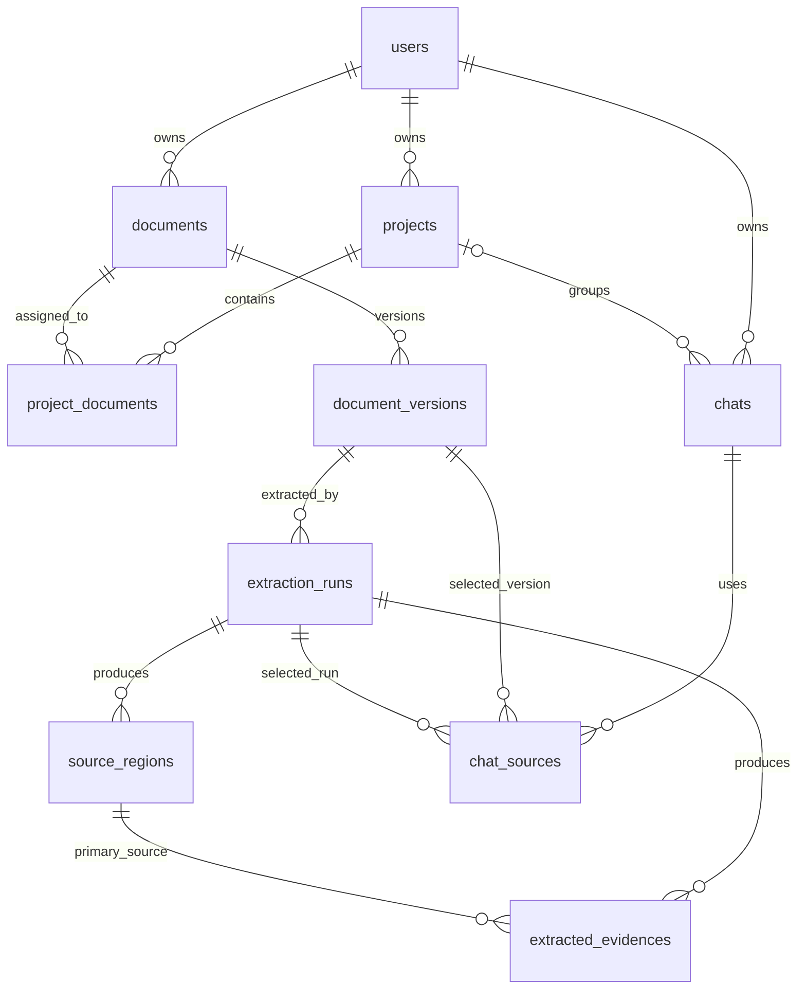
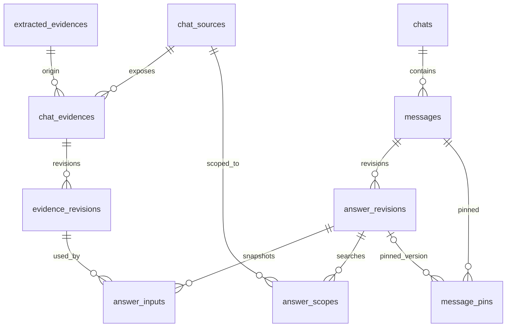

# Thiet ke du lieu ban dau

## 1. Muc tieu

Mo hinh phai tra loi duoc bon cau hoi o moi thoi diem:

1. Nguoi dung dang xem dung phien ban PDF va lan trich xuat nao?
2. Cau tra loi nay da dung chinh xac ban can cu nao?
3. Neu mot can cu thay doi, cau tra loi nao va pham vi nao can tinh lai?
4. Co the mo lai lich su ma khong bi ket qua moi ghi de khong?

PostgreSQL la source of truth cho metadata/quan he/lich su. PDF, page image va crop lon nam trong object storage qua `storage_key`.

## 2. Nhom bang (23 bang)

| Nhom | Bang | Vai tro |
|---|---|---|
| Tai khoan | `users`, `auth_sessions`, `account_tokens` | Danh tinh, session, token mot lan |
| Thu vien | `projects`, `documents`, `document_versions`, `project_documents` | To chuc va version PDF |
| Trich xuat | `extraction_runs`, `source_regions`, `extracted_evidences` | Ket qua goc bat bien |
| Hoi thoai | `chats`, `chat_sources`, `messages`, `message_pins` | Phien, nguon, thu tu message, ghim |
| Can cu | `chat_evidences`, `evidence_revisions` | Working copy rieng cua chat va lich su |
| Cau tra loi | `answer_revisions`, `answer_inputs`, `answer_scopes` | Ket qua bat bien, input da dung, pham vi phu thuoc |
| Van hanh | `jobs`, `job_events`, `audit_events`, `request_keys` | Async, progress, audit, idempotency |

## 3. Hai lop can cu

- `extracted_evidences`: du lieu goc cua mot `extraction_run`; khong sua sau `completed`.
- `chat_evidences`: lien ket mot can cu goc vao mot chat.
- `evidence_revisions`: snapshot day du cua gia tri/semantic dang dung trong chat. Verify, edit, mark error va restore deu tao revision moi.

Chinh sua trong chat A khong thay doi chat B du hai chat dung cung PDF. Gia tri goc van truy cap duoc de doi chieu.

## 4. Lich su cau tra loi va phu thuoc

- `messages` la dong hoi thoai; assistant message co con tro `current_answer_revision_id`.
- `answer_revisions` bat bien, luu structured operation/result/assessment va `input_data_revision`.
- `answer_inputs` chup dung evidence revision da dung. Day la direct dependency.
- `answer_scopes` luu toan bo nhom/nguon/filter da xem xet. Day la scope dependency, can thiet cho ranking va can cu moi xuat hien sau nay.

Khong tinh lai bang cach thay mot so vao answer cu. Worker phai tai lai toan scope tai snapshot va tao answer revision moi.

## 5. Truong semantic chuan

`semantic` la JSONB duoc validate boi JSON Schema versioned. Cau truc toi thieu:

```json
{
  "schema_version": 1,
  "measure": {"code": null, "label": "Doanh thu thuan"},
  "subject": {"code": null, "label": "Mien Bac"},
  "unit": {"code": "VND_MILLION", "label": "trieu dong", "multiplier": "1000000"},
  "period": {
    "status": "known",
    "label": "Quy 1 nam 2025",
    "start": "2025-01-01",
    "end": "2025-03-31",
    "basis": "explicit",
    "source_region_ids": ["uuid"]
  },
  "dimensions": {},
  "value_operator": "eq"
}
```

`period.status`: `known|partial|unspecified|not_applicable`. `basis`: `explicit|context|user`; explicit/context phai tro den source region, user phai co reason/audit.

## 6. Bat bien va rang buoc

- Email unique sau normalize; password chi luu hash.
- `version_no`, `revision_no`, `sequence_no`, `event_no` tang duong va unique trong parent.
- `extraction_run=completed` moi duoc gan lam chat source.
- Source region va extracted evidence phai cung extraction run.
- `value_kind=number` + `valid` yeu cau numeric value va text null; text thi nguoc lai; missing/error co effective value null.
- `current_revision_id` va `current_answer_revision_id` phai tro ve revision cua cung entity/chat.
- Tat ca lien ket answer-input-scope-source-evidence phai cung `chat_id`. DDL denormalize `chat_id` o revision/link table de FK ghep bao ve dieu nay.
- `bbox` null hoac mang bon so thoa `0 <= x0 < x1 <= 1`, `0 <= y0 < y1 <= 1`; validation chi tiet o app va co the bo sung DB function.
- Khong luu NaN/Infinity; decimal dung `NUMERIC`.
- Ghi revision + doi current pointer + tang data revision trong mot transaction.

## 7. State machine

### Extraction run

`queued -> running -> completed|failed`; retry tao run moi hoac reset failed theo policy da ghi, khong sua completed.

### Message

User: `accepted`. Assistant: `processing -> completed|failed`; `needs_update` la co doc lap sau evidence change.

### Job

`queued -> running -> succeeded|failed|cancelled|superseded`. Lease het han cho phep reclaim; publish van phai kiem revision fence.

### Source

`active -> inactive`; khong xoa lien ket cu neu answer history con dung.

## 8. Transaction quan trong

- Upload: metadata + job idempotent.
- Publish answer: answer revision + inputs + scopes + current pointer + job success.
- Edit evidence: evidence revision + current pointer + chat revision + mark affected + recalc jobs.
- Switch source: active/inactive transition + chat revision.

Khong goi AI/storage cham trong transaction DB.

## 9. Chi muc va truy van nong

- Chat list: `(owner_id, updated_at desc)`.
- Message history: `(chat_id, sequence_no)`.
- Evidence by source: `(chat_source_id, extracted_evidence_id)`.
- Revision history: `(entity_id, revision_no desc)`.
- Dependency lookup: `answer_inputs(evidence_revision_id)` va `answer_scopes(chat_source_id)`.
- Worker claim: partial index `jobs(status, available_at)` cho queued/running expired.
- Idempotency: `(owner_id, route, key)`.

## 10. Xoa va retention

MVP dung soft delete `deleted_at`/archive cho document va chat. Permanent purge phai:

1. khoa resource va huy job;
2. xu ly theo thu tu dependency;
3. chi xoa object khi khong con history reference;
4. ghi audit event khong chua noi dung nhay cam.

Thoi gian retention, account deletion SLA va du lieu user study phai duoc chot truoc khi thu nghiem nguoi dung.

## 11. DDL va migration

`initial-schema.sql` la baseline review/prototype, khong thay the migration. Khi scaffold backend, chuyen no thanh Alembic migration `0001`, chay test up/down va them trigger/constraint con thieu sau khi co test race condition.

## 12. So do quan he

### 12.1 Thu vien, trich xuat va chat



### 12.2 Can cu, cau tra loi va lich su



Con tro `chat_evidences.current_revision_id` va `messages.current_answer_revision_id` tao quan he nguoc den revision hien hanh. Day la quan he vong co chu dich va FK duoc de `DEFERRABLE` de revision va con tro co the ghi trong cung transaction.

## 13. Data dictionary chi tiet

Quy uoc cot:

- `PK`: khoa chinh UUID server-generated.
- `FK`: khoa ngoai; `FK*` la FK ghep de bao ve cung owner/chat/run.
- `UK`: rang buoc duy nhat.
- `snapshot`: du lieu bat bien sau khi tao.
- `pointer`: duoc update nhung chi tro den revision hop le.

### 13.1 Tai khoan va xac thuc

#### `users`

| Truong | Bat buoc | Quy tac |
|---|---|---|
| `id` | Co | PK; khong nhan tu client |
| `email` | Co | Gia tri de hien thi/gui thu; khong dung truc tiep de so sanh |
| `normalized_email` | Co | lower-case + normalize theo policy; UK |
| `password_hash` | Co | Argon2id; khong bao gio tra ve API/log |
| `display_name` | Co | Trim, gioi han do dai o contract |
| `created_at`, `updated_at` | Co | Server UTC |
| `deleted_at` | Khong | Soft-delete account trong thoi gian cho purge |

Khong cascade lich su nghiep vu khi xoa user. Account deletion la workflow rieng; FK nghiep vu de `RESTRICT` den khi purge plan hoan tat.

#### `auth_sessions`

- Mot row cho mot lan dang nhap/thiet bi.
- Chi luu `token_hash`; raw token chi tra mot lan qua cookie an toan.
- Session hop le khi `now < expires_at` va `revoked_at IS NULL`.
- `last_seen_at` co the cap nhat theo throttle, khong update moi request.

#### `account_tokens`

- Token mot lan cho `verify_email|reset_password`.
- Hop le khi chua `used_at`, chua het han va token hash khop.
- Mark used va thay doi account state trong cung transaction de tranh dung hai lan.

### 13.2 Thu vien tai lieu

#### `projects`

- So huu boi `owner_id`; ten khong rong.
- Project la cach nhom, khong quyet dinh quyen chia se trong MVP.
- Xoa project khong xoa document; chi xoa lien ket `project_documents` sau khi da xu ly chat tham chieu.

#### `documents`

- Dai dien danh tinh logic cua tai lieu qua nhieu lan upload.
- `title` la ten hien thi, khong phai ten object storage.
- `owner_id` bat bien trong MVP; khong co chuyen ownership.

#### `project_documents`

- Bang noi many-to-many, PK `(project_id, document_id)`.
- `owner_id` duoc denormalize chi de FK ghep dam bao project va document cung owner.
- Khong cho client ghi owner; service lay tu authenticated user.

#### `document_versions`

| Nhom truong | Y nghia |
|---|---|
| `document_id`, `version_no` | UK; version tang trong mot document |
| `file_name` | Ten goc da sanitize de hien thi |
| `storage_key` | UK; server-generated; khong chua path tu client |
| `file_hash` | SHA-256 raw bytes, dung de deduplicate/canh bao |
| `content_type`, `byte_size`, `page_count` | Metadata da validate; page count co sau inspect |
| `status` | `uploaded|processing|ready|failed|deleted` |
| `uploaded_at` | Thoi diem van hanh, khong phai ky so lieu |

Tai file moi luon tao version moi. Khong thay bytes phia sau mot `storage_key` da duoc answer history tham chieu.

### 13.3 Ket qua trich xuat goc

#### `extraction_runs`

- Mot attempt/version cau hinh extractor tren mot document version.
- `run_no` tang theo document version; `extractor_name/version/config` giup tai tao.
- `completed_at` chi co khi completed/failed; error detail nhay cam khong luu nguyen prompt/PDF.
- Chuyen `completed` lam run bat bien; reprocess tao run moi.

#### `source_regions`

| Truong | Y nghia va validation |
|---|---|
| `region_key` | Ma on dinh trong output cua run, nullable; unique neu co |
| `page_number` | 1-based, khong vuot page count |
| `bbox` | Null hoac 4 decimal chuan hoa, goc tren-trai |
| `region_type` | paragraph/table/table_cell/chart/chart_element/image/other |
| `extracted_text` | Text cua region neu co; khong dung thay raw file |
| `meta` | Schema theo region type: row/column index, chart type, parent region... |

Can co `bbox_schema_version` trong `meta` neu sau nay doi quy uoc toa do.

#### `extracted_evidences`

- Mot fact/statement chuan hoa tu mot region chinh.
- `raw_value` va `raw_text` loai tru nhau theo `value_kind`.
- `data_status=missing|error` thi ca hai raw value null; diagnostic nam trong `semantic/meta`, khong dat gia tri gia.
- `extraction_method` phan biet direct label, axis estimation, table, text, OCR va none.
- `confidence` chi la metadata cua extractor, khong tu dong bien thanh verified.
- FK ghep bat buoc evidence va source region cung extraction run.

### 13.4 Chat va nguon dang dung

#### `chats`

- Thuoc mot owner; project tuy chon nhung neu co phai cung owner.
- `data_revision` la monotonic counter. Tang khi active source, current evidence hoac du lieu anh huong answer thay doi.
- `next_sequence_no` cap hai sequence lien tiep cho user/assistant message duoi chat row lock.
- Doi title/archive khong can tang `data_revision`.
- `updated_at` phuc vu sap xep danh sach; khong dung lam concurrency fence.

#### `chat_sources`

- Chot dung `document_version_id` va `extraction_run_id`.
- Chua duoc activate run khong completed.
- Mot run chi gan mot lan vao mot chat; source cu chuyen inactive, khong xoa.
- `deactivated_at` phai co neu inactive va null neu active.

#### `messages`

| Truong | Quy tac |
|---|---|
| `role` | user hoac assistant; answer revision chi gan assistant |
| `reply_to_message_id` | Assistant tro den user message cung chat |
| `sequence_no` | UK trong chat; cap bang counter/lock, khong dung `max()+1` khong lock |
| `status` | user accepted; assistant processing/completed/failed |
| `needs_update` | True khi current answer khong con phu hop current data revision |
| `current_answer_revision_id` | Pointer den revision cua chinh message |

`content` cua assistant co the la placeholder ngan; noi dung answer chinh thuc nam trong `answer_revisions.answer_text`.

#### `message_pins`

- Pin message: `answer_revision_id IS NULL`.
- Pin answer cu the: co `answer_revision_id`; UI co the bao co ban moi.
- Hai partial unique index ngan pin trung.
- Pin khong lam revision tro thanh current.

### 13.5 Can cu lam viec theo chat

#### `chat_evidences`

- Mapping duy nhat `(chat, source, extracted evidence)`.
- `extraction_run_id` duoc denormalize de FK ghep va truy van nhanh; trigger/service phai dam bao bang run cua `chat_source`.
- `current_revision_id` la pointer duy nhat duoc update.
- Khoi tao lazy khi can cu lan dau duoc dung hoac hien trong evidence panel.

#### `evidence_revisions`

| Nhom truong | Quy tac |
|---|---|
| `revision_no` | Tang trong chat evidence; unique |
| `numeric_value/text_value` | Effective value snapshot, loai tru theo value kind |
| `semantic` | Snapshot day du, khong chi delta so voi ban truoc |
| `data_status` | valid/missing/error |
| `verification_status` | unverified/verified/edited |
| `action` | initialize/verify/edit/mark_error/restore |
| `reason` | Bat buoc cho edit, mark_error, restore |
| `created_by/at` | Actor va thoi diem server |

`restore` khong quay con tro ve row cu. No copy snapshot cu thanh revision moi de lich su van tuyen tinh.

### 13.6 Answer, input va pham vi

#### `answer_revisions`

- Chi thuoc assistant message cung chat.
- `answer_status` quyet dinh co duoc trinh bay nhu ket luan hay la yeu cau/loi co cau truc.
- `question_context` la yeu cau da parse, gom measure, subject, periods, operation, scope va ambiguity.
- `operation` va `result` la JSON co schema/version; result so luu decimal string neu dua qua API.
- `assessment` chua completeness, reason code, warning va claim/evidence mapping neu MVP chua tach table claim.
- `input_data_revision` la snapshot fence; khong nhat thiet bang current revision khi xem lai lich su.

#### `answer_inputs`

- PK gom answer, evidence revision va param key.
- `role=operand` cho input phep tinh, `comparison_group` cho toan bo member ranking, `context_text` cho dinh nghia/dieu kien.
- `param_key` on dinh trong operation, vi du `MB_Q1`, khong phu thuoc thu tu hien thi.
- `chat_id` denormalized va FK ghep dam bao answer/evidence cung chat.

#### `answer_scopes`

- `filter` mo ta tap can cu da/nen duoc xet, khong chi input da chon.
- Toi thieu gom schema version, measure, subject selector, periods, dimensions, source region/chart neu co va `all_subjects`.
- Dung de phat hien member moi hoac evidence thay doi co the doi winner/ranking.
- Filter phai canonicalize truoc khi ghi de unique/hash/match on dinh.

### 13.7 Van hanh va kiem soat

#### `jobs`

- `kind`, `payload` co schema version va ID tham chieu; khong nhung binary/PDF/prompt lon.
- `dedup_key` unique cho mot logical effect, vi du `recalculate:{message_id}:{data_revision}`.
- Worker claim atomic: queued + available -> running + lease token/expiry + attempts.
- `input_data_revision` bat buoc cho answer/recalculate, null cho extraction.
- `result` chi chua summary/resource IDs; output nghiep vu o bang domain.
- Retry chi khi transient va `attempts < max_attempts`; loi validation khong retry.

#### `job_events`

- Event number tang trong job; phuc vu reconnect/progress.
- Payload nho, co the xoa theo retention sau khi job final; khong phai audit/domain history.

#### `audit_events`

- Ghi login security, ownership/admin, purge, edit quan trong.
- Khong nhan vai tro thay `evidence_revisions`/`answer_revisions`.
- Metadata khong chua password, token, PDF text day du hoac raw prompt nhay cam.

#### `request_keys`

- PK `(owner, route, key)`.
- `request_hash` tren canonical request. Cung key/khac hash -> 409.
- Luu status/response du nho de replay; resource lon chi luu ID.
- Xoa sau `expires_at` boi scheduled job.

## 14. JSONB contract va versioning

JSONB chi dung khi shape thay doi theo loai; identity, ownership, state va quan he phai la cot co kieu. Moi JSON document co `schema_version` integer.

### 14.1 `semantic` v1

Bat buoc:

- `measure.label` khong rong.
- `unit` co the null; neu co, `multiplier` la decimal string duong.
- `period.status` luon co; known can start/end, partial khong duoc gia mao start/end.
- `value_operator`: `eq|gt|gte|lt|lte|approx`.
- `dimensions`: object key/value scalar da normalize.

### 14.2 `question_context` v1

```json
{
  "schema_version": 1,
  "measure": {"label": "Doanh thu"},
  "subjects": {"mode": "all_in_scope", "values": []},
  "requested_periods": [
    {"label": "Quy 1", "status": "partial"},
    {"label": "Quy 3", "status": "partial"}
  ],
  "time_required": true,
  "operation": "growth_rate_ranking",
  "comparison_basis": "percent",
  "dimensions": {},
  "ambiguities": []
}
```

Neu `ambiguities` khong rong va anh huong ket luan, answer status phai la `needs_clarification`.

### 14.3 `operation`/`result` v1

- Operation name nam trong allowlist: lookup, sum, difference, absolute_change, growth_rate, compare, ranking.
- Formula implementation co version, vi du `calculator_version=1`.
- Result luu exact decimal, ties, undefined reason va presentation rounding rieng.
- Khong luu ket qua NaN/Infinity; dung `defined=false` va reason code.

### 14.4 `answer_scopes.filter` v1

```json
{
  "schema_version": 1,
  "measure_key": "doanh_thu",
  "subject_mode": "all",
  "period_keys": ["Q1", "Q3"],
  "dimensions": {},
  "region_ids": ["uuid"],
  "include_text_context": true
}
```

App luu canonical JSON: key order khong co y nghia, array set phai sort/deduplicate neu thu tu khong co y nghia.

### 14.5 Contract tích hợp extraction/planning/calculation

Ba contract mới dùng ở ranh giới component, trước khi map vào các bảng/revision:

- `document-evidence-v2`: batch `base_document` hoặc `on_demand_chart`. Mỗi số bắt buộc có trang, bbox, decimal string, semantic và phương pháp đọc. Batch chart phải liên kết `question_plan_id` và chỉ chứa fact/chart nằm trong trigger.
- `question-plan-v2`: lưu trong job payload/audit khi planner biến câu hỏi thành fact, kỳ, unit, operand order và `formula_id`; plan mơ hồ có trạng thái `needs_clarification` và không được chạy downstream.
- `calculation-result-v1`: lưu cùng answer revision/job result; snapshot operand bằng `evidence_revision_id`. Trạng thái lỗi có `value=null`, reason code ổn định.

Các contract này không thay thế identity/FK. Khi publish, service resolve key tạm của provider thành UUID domain, validate owner/document version, rồi ghi extracted evidence hoặc revision trong transaction. Chi tiết field và sequence tại [HANDOUT/integration-contract.md](HANDOUT/integration-contract.md).

## 15. Bat bien lien bang va noi thuc thi

| Bat bien | DB constraint | Trigger | Service/test |
|---|---:|---:|---:|
| Project/document/chat cung owner | FK ghep |  | Co |
| Region/evidence cung extraction run | FK ghep |  | Co |
| Chat source chon run cua dung document version | FK ghep |  | Co |
| Chat source chi activate run completed/cung owner |  | Co trong baseline | Co |
| Chat evidence origin nam trong run cua chat source | Mot phan | Co trong baseline | Co |
| Current evidence revision thuoc dung chat evidence | Mot phan | Co, deferred | Co |
| Answer revision chi thuoc assistant message |  | Co trong baseline | Co |
| Current answer revision thuoc dung message | Mot phan | Co, deferred | Co |
| Answer input/scope cung chat | FK ghep |  | Co |
| Completed extraction va revision bat bien |  | Co trong baseline | Co |
| Bbox co 4 so hop le | Function/check |  | Co |
| Revision/sequence tang khong trung | UK |  | Co |

Nguyen tac: constraint quan trong van phai co test service vi trigger/DDL khong thay the error mapping va authorization.

## 16. Transaction va concurrency

### 16.1 Isolation

- Mac dinh `READ COMMITTED`.
- Dung row lock `SELECT ... FOR UPDATE` cho chat/evidence/message khi cap counter/pointer.
- Khong giu transaction trong luc goi object storage, extractor, LLM/VLM.
- Deadlock retry toi da co gioi han va log request/job ID.

### 16.2 Tao message

1. Lock chat.
2. Doc/tang sequence trong transaction (co the them `chats.next_sequence_no` khi trien khai de tranh `max()`).
3. Ghi user + assistant placeholder + job + request key.
4. Commit; worker xu ly sau.

### 16.3 Khoi tao/sua evidence

1. Lock `chat_evidences` va chat.
2. So `expected_revision_id` voi current; lech -> 409.
3. Lay `next revision_no` duoi lock; insert snapshot.
4. Update pointer, tang `data_revision`.
5. Mark answer bi anh huong va insert unique recalc jobs.
6. Commit.

### 16.4 Publish answer

1. Lock job, chat va assistant message theo thu tu on dinh.
2. Kiem job running, lease token, quyen va `chat.data_revision == input_data_revision`.
3. Insert answer revision, inputs, scopes.
4. Update message pointer/status/needs_update.
5. Mark job succeeded va event final.
6. Commit. Neu fence sai, mark superseded va khong ghi answer current.

### 16.5 Thu tu lock de tranh deadlock

`users/resources owner -> chats -> chat_sources/chat_evidences -> messages -> jobs`.

Moi service mutating phai theo thu tu nay hoac ghi ro ngoai le trong ADR.

## 17. Thuat toan xac dinh answer bi anh huong

Input: `chat_evidence_id`, revision cu/moi, chat revision moi.

1. Direct set: current answer revisions co `answer_inputs.evidence_revision_id` tro revision cu.
2. Scope set: current answer revisions co `answer_scopes` tren cung chat source va filter match semantic cu hoac moi.
3. Union hai set; loai answer khong con current neu policy chi recalc current.
4. Mark message `needs_update=true`.
5. Upsert job theo unique logical key `(message_id, input_data_revision, kind)`; nen them unique index khi migration thuc te.
6. Worker tai current evidence cua toan scope, khong reuse result cu.

Scope matcher v1 la exact structured matching sau canonicalization. Khong dung embedding/LLM de quyet dinh dependency trong MVP.

## 18. Truy van nghiep vu chinh

### 18.1 Mo chat

- Query chat theo `(id, owner_id)`.
- Page messages theo `(chat_id, sequence_no)`.
- Join current answer revision cho page hien tai; inputs/evidence tai theo batch, tranh N+1.
- History revision chi tai khi nguoi dung mo chi tiet.

### 18.2 Mo answer cu

- Tai `answer_revisions` theo ID + owner chain.
- Tai `answer_inputs` -> dung `evidence_revisions`, khong join current pointer.
- Tai source region/document version tu origin chain de tao citation.

### 18.3 Evidence panel

- Filter theo chat source, page/region/measure.
- Join current revision va raw extracted evidence de hien raw vs effective.
- Sort deterministic theo page, bbox top/left, region/evidence ID.

### 18.4 Worker claim

Dung `FOR UPDATE SKIP LOCKED`, uu tien `available_at, created_at`, set lease token/expiry trong cung statement/transaction. Reclaim running job chi khi lease expired va attempt policy cho phep.

### 18.5 Purge

- Chon soft-deleted resource qua batch.
- Kiem history reference va legal/retention hold.
- Xoa child theo thu tu ro rang; object storage xoa sau DB plan, co retry/idempotency.
- Neu object delete loi, giu tombstone/job de tiep tuc, khong khoi phuc resource tren UI.

## 19. Dung luong, phan vung va retention

Uoc luong MVP can do truoc khi deploy:

- `source_regions` va `extracted_evidences` tang theo page/element.
- `evidence_revisions` tang theo edit/verify, thuong nho.
- `answer_revisions/inputs/scopes` tang theo question va recalc.
- `job_events` va `audit_events` tang nhanh nhat theo van hanh.

MVP chua can partition. Dat metric row count/size; xem xet monthly partition cho audit/job events khi size/retention gay vacuum/query issue. De xuat retention ban dau can duyet:

| Du lieu | De xuat |
|---|---|
| Domain history dang active | Giu den khi user purge account/resource |
| Job events | 30 ngay sau final, giu final summary lau hon trong job |
| Request keys | 24-72 gio theo route |
| Auth/account token | Xoa/vo hieu sau expiry + grace ngan |
| Audit security | 90 ngay hoac theo chinh sach nghien cuu |
| User study raw data | Theo consent/protocol rieng, khong tron DB san pham neu co the |

Con so tren la proposed; phai chot trong `open-questions.md` truoc user study.

## 20. Bao mat va du lieu nhay cam

- Moi repository query bat dau tu owner scope; API tra 404 cho ID khong thuoc owner.
- Storage key server-generated; signed URL ngan han va chi sau ownership check.
- Encrypt at rest dua vao PostgreSQL/storage platform; TLS in transit.
- Backup duoc ma hoa, test restore va cung retention/purge policy.
- Khong log raw token, password, full PDF, full prompt/response chua noi dung nguoi dung.
- Audit metadata dung allowlist; khong dump request body.
- `reason` edit co the chua noi dung nguoi dung, nen gioi han do dai va escape khi hien thi.

## 21. Migration va thay doi schema

### 21.1 Quy tac

- Alembic migration bat bien sau khi merge; sua bang migration moi.
- Expand/contract cho thay doi khong downtime: them nullable/backfill/dual-read-write/constraint/not-null/cleanup.
- JSON schema moi them version; reader ho tro it nhat version hien tai va version truoc trong giai doan chuyen.
- Index lon tao `CONCURRENTLY` ngoai transaction production neu can.

### 21.2 Test migration

1. Up tren database rong.
2. Up tu snapshot phien ban truoc co du lieu bien.
3. Kiem FK/check/index va bat bien bang negative cases.
4. Down chi bat buoc khi an toan; migration mat du lieu phai co restore/forward-fix plan.
5. Chay query plan cho hot queries voi data volume gia lap.

### 21.3 Trang thai baseline `initial-schema.sql`

Da co: bbox function/check, source activation/owner trigger, chat-evidence origin trigger, deferred current-pointer trigger, assistant-answer trigger, completed extraction/revision immutability, `jobs.dedup_key`, `chats.next_sequence_no` va cac index chinh.

Can production migration/test truoc deploy:

- `updated_at` strategy (application hay trigger) va clock policy.
- Controlled permanent-purge path voi DB role rieng; app role khong duoc vo hieu immutability trigger.
- Constraint/validator cho JSON Schema version va canonical scope.
- Lease heartbeat/reclaim SQL function de claim atomic.
- Negative integration test cho moi trigger/check va query-plan test voi volume gia lap.

## 22. Vi du end-to-end trong data

Tinh huong: answer dau dung Mien Bac Q1=38, Q3=87 va Mien Nam Q1=50, Q3=90; ket luan Mien Bac tang cao nhat. Nguoi dung sua Mien Bac Q1 thanh 58.

### Truoc khi sua

- `extracted_evidences.raw_value=38` bat bien.
- `chat_evidences.current_revision_id -> ER1`, `ER1.numeric_value=38`.
- `answer_revisions AR1.input_data_revision=7`.
- `answer_inputs` cua AR1 tro ER1 va ba revision con lai.
- `answer_scopes` cua AR1 co `all subjects` cho Q1/Q3.

### Transaction sua

- Tao ER2 voi numeric value 58, action edit, reason.
- Chuyen pointer ER1 -> ER2.
- Tang chat revision 7 -> 8.
- AR1/message bi mark needs update boi direct input va scope.
- Tao recalc job input revision 8.

### Sau tinh lai

- Worker tai lai ca bon operand tai revision 8.
- Tao AR2: Mien Bac 50%, Mien Nam 80%, winner Mien Nam.
- Message current pointer AR1 -> AR2, needs_update false.
- AR1 van mo lai dung ER1=38; raw value van 38; chat khac van dung revision cua chinh no.

Day la acceptance scenario bat buoc cho DB integration va E2E test.
