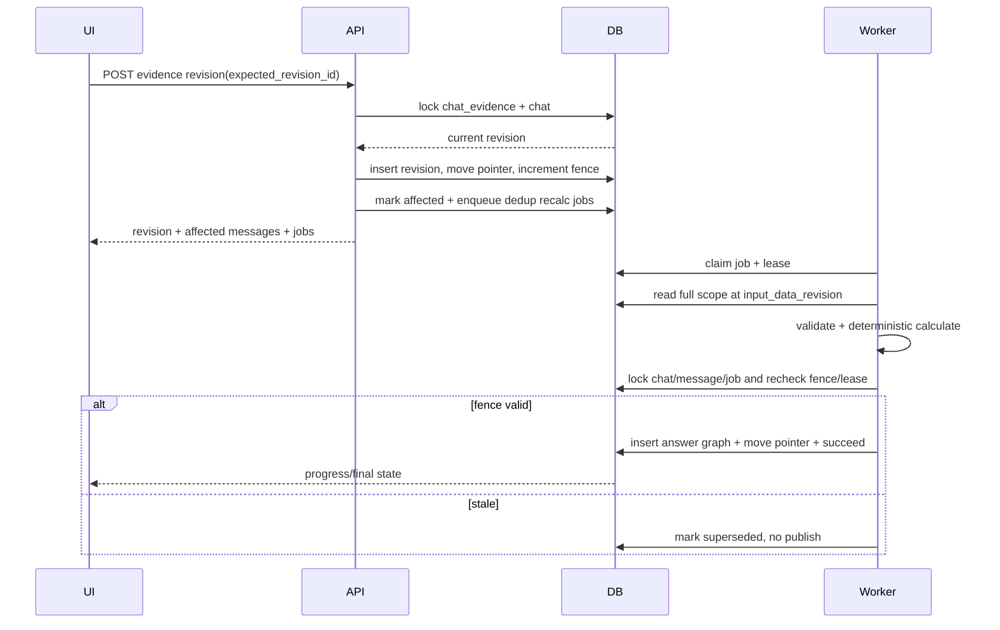

# Luong xu ly va ranh gioi giao dich

## 1. Nap tai lieu

1. API xac thuc owner, validate ten/MIME/magic byte/kich thuoc/page limit so bo.
2. Tao `document` neu moi, `document_version`, storage key va job `extract_document` trong mot giao dich.
3. Upload/commit file theo co che da chon; neu storage loi, danh dau phien ban loi va cho retry/cleanup.
4. Worker claim job bang lease, tao `extraction_run=running`.
5. Adapter tao source regions va extracted evidence; validator kiem page, bbox, value/status/semantic.
6. Ghi ket qua theo batch; chi chuyen run sang `completed` khi toan bo batch hop le. Run `failed` khong duoc chon lam chat source.

Ket qua `completed` bat bien. Re-extract tao run moi, khong ghi de run cu.

## 2. Dat cau hoi va tra loi

### Giao dich A - tiep nhan

1. Kiem ownership va `Idempotency-Key`.
2. Ghi user message voi `sequence_no` moi.
3. Ghi assistant placeholder `processing`, lien ket `reply_to_message_id`.
4. Chup `chat.data_revision`, tao job `answer_question`.

### Worker - xu ly

1. Tai history can thiet va chat sources dang active tai cung data revision.
2. Parse `question_context`: measure, subject, requested periods, operation, comparison scope, `time_required`.
3. Neu mo ho: tao answer revision `needs_clarification`; khong tu chon cach hieu.
4. Retrieve text/table evidence; chi goi chart adapter cho chart lien quan.
5. Normalize va validate value, unit, period, extraction method, status.
6. Tao chat evidence/revision dau neu can.
7. Calculator code chay operation; LLM (neu dung) chi dien dat tu structured result.

### Giao dich B - cong bo

1. Lock chat/message can thiet va kiem lease + quyen + `data_revision` van bang snapshot.
2. Ghi `answer_revision`, `answer_inputs`, `answer_scopes`.
3. Chuyen `current_answer_revision_id`, message `completed`, `needs_update=false`.
4. Ghi job event/final status va idempotent response.

Neu data revision da doi, bo ket qua, tao/requeue job cho revision moi neu van can.

## 3. Sua hoac xac nhan can cu

Request gui `chat_evidence_id`, `expected_revision_id`, noi dung moi va ly do neu edit/error/restore.

Trong mot giao dich:

1. Kiem owner va current revision trung `expected_revision_id`; neu khong tra `409 revision_conflict`.
2. Validate value/status/semantic. Tao `evidence_revision` day du, bat bien.
3. Chuyen `current_revision_id`, tang `chat.data_revision`.
4. Tim answer hien hanh bi anh huong boi:
   - direct dependency qua `answer_inputs`; hoac
   - scope match qua `answer_scopes` (bat buoc voi ranking/group comparison).
5. Dat message `needs_update=true` va tao duy nhat mot recalculate job cho `(message, data_revision)`.
6. Commit truoc khi goi model/calculator.

Neu tinh lai loi, revision vua sua van ton tai; UI hien cau tra loi can update va nut retry.

### Week 1 local runtime implementation

The running local session API implements the persistence half of this flow:
it creates an immutable `initialize` snapshot for each extracted number,
appends an `edit` snapshot with both old/new values and reason, checks
`expected_revision_id`, and marks answer messages whose saved `answer_inputs`
refer to the superseded revision as `needs_update`. Automatic recalculation is
the next worker-backed step; the Week 1 local endpoint deliberately does not
rewrite a historical answer after an edit.

## 4. Tinh lai

- Lay lai toan bo scope, khong chi thay mot operand trong ket qua cu.
- Dung current evidence revisions tai snapshot.
- Tao answer revision moi; ban cu va input cu van bat bien.
- Cong bo chi khi revision fence con hop le.
- Pin gan answer revision cu van mo duoc va hien co ban moi.

## 5. Chuyen document version trong chat

- Them chat source moi sau khi extraction run moi completed.
- Danh source cu inactive cho cau hoi tiep theo; khong xoa.
- Khong tu dong mang edit cu sang evidence moi. UI cung cap doi chieu va thao tac xac nhan chuyen doi.
- Answer cu tiep tuc tro dung document version/extraction run cu.

## 6. Failure matrix

| Loi | Trang thai/hanh vi |
|---|---|
| PDF khong hop le/qua gioi han | 422, khong tao extraction job |
| Extractor timeout/crash | run/job failed, cho retry co gioi han |
| AI output sai schema | retry toi da N; sau do processing_error, luu diagnostic an toan |
| Missing data | answer `insufficient_data`; khong thay bang 0 |
| Ambiguous operation/period | `needs_clarification` |
| Conflicting table/chart | `source_conflict`, yeu cau chon nguon |
| Division by zero | structured undefined result, khong Infinity/NaN |
| Unit incompatible | khong tinh; neu ro hai unit |
| Concurrent edit | 409, client tai current revision |
| Stale worker result | discard, event `superseded` |
| Reconnect | UI tai `job_events` tu event number cuoi |

## 7. Precondition va postcondition theo use case

| Use case | Precondition | Commit point | Postcondition |
|---|---|---|---|
| Upload | owner active, PDF envelope hop le | version + extraction job | response 202 co IDs; retry khong tao duplicate |
| Complete extraction | worker co lease, run running | payload + run completed | payload bat bien, run co the activate |
| Submit question | owner co chat/source active | 2 messages + answer job + request key | sequence lien tuc, response replay duoc |
| Publish answer | job/lease/fence/quyen hop le | revision + input + scope + pointer | message completed, history cu giu nguyen |
| Edit evidence | expected current revision khop | revision + pointer + fence + jobs | edit ton tai ke ca recalc that bai |
| Recalculate | job fence bang current | answer revision moi + pointer | needs_update false; job succeeded |
| Switch source | new run completed/cung owner | old inactive + new active + fence | answer cu van tro source cu |
| Purge | retention cho phep, resource tombstoned | dependency/object cleanup state | idempotent, khong orphan reference |

## 8. Sequence - sua va tinh lai

## 9. Compensation va retry

- Storage upload thanh cong nhung DB fail: object o staging prefix, cleanup theo TTL.
- DB metadata thanh cong nhung object finalize fail: version `failed`, retry finalize hoac purge; khong schedule extract.
- Worker crash sau domain commit truoc ack: reclaim job thay final state/dedup va khong lap effect.
- Provider timeout: retry co backoff neu transient; invalid schema retry toi da policy, sau do `processing_error`.
- Publish conflict do fence: khong retry cung output; job superseded va schedule snapshot moi neu message van can.
- Recalc fail: evidence edit van current, message giu `needs_update=true`, UI co retry.

## 10. Ordering va lock

Thu tu lock: owner resource -> chat -> source/evidence -> message -> job. Message sequence cap tu `chats.next_sequence_no` duoi chat lock. Revision number cap duoi parent lock. Khong dung `MAX()+1` ngoai lock.

## 11. Event semantics

`job_events` la progress transport, khong phai source of truth. Event toi thieu: queued, started, progress, retrying, succeeded, failed, cancelled, superseded. Client sau reconnect dung `after=event_no`, sau event final van GET resource de xac nhan state.

## 12. Local session upload and retrieval slice

1. Server resolves the session with its fixed local owner; the client cannot supply `owner_id`.
2. Upload validates `.pdf` name and PDF magic bytes, then streams 1 MiB chunks to a temporary file while updating SHA-256 and byte count.
3. If the count exceeds 100 MiB or validation fails, delete the temporary file and do not publish metadata.
4. Atomically move the completed binary to `runtime/uploads/{document_id}.pdf` and append document metadata to `runtime/sessions.json`.
5. Extract text by page to `runtime/extracted/{document_id}.json`; store a visible `ready/failed` extraction status.
6. A document question retrieves up to three pages with deterministic token overlap, records a context manifest, and rejects a non-summary question below the minimum retrieval score (currently 2) as `NO_TEXT_EVIDENCE` instead of sending unrelated context to an AI provider. A successful question appends user/assistant messages and page citations, then persists the session catalog.

This slice intentionally has no fabricated bbox. Citation `bbox` remains null until a layout-aware extraction provider succeeds.

## 13. Terminal audit for the local slice

The API emits structured `FLOW` log lines for every HTTP request and for the session data path. The records include `trace_id`, resource IDs, status, byte size/hash, extraction state, selected page/score and persistence outcome. They do not include PDF text, user questions, prompts, provider payloads or tokens.

For an upload, the expected order is `HTTP_IN -> UPLOAD_ACCEPTED -> DOCUMENT_STORED -> EXTRACTION_STARTED -> EXTRACTION_FINISHED -> HTTP_OUT`. For a question, the target order is `HTTP_IN -> QUESTION_PLAN_CREATED -> BASE_EVIDENCE_RESOLVED -> CHART_READ_REQUESTED? -> OPERANDS_BOUND -> CALCULATION_SUCCEEDED|CALCULATION_REJECTED -> ANSWER_PERSISTED -> HTTP_OUT`. The `X-Trace-Id` response header and terminal `trace_id` correlate the request; the persisted message trace is the only product trace surface.

P0 runtime implements the same sequence with persisted lower-case trace stages: `question_received -> question_plan -> retrieval -> evidence_resolution -> chart_read? -> calculation -> answer_generation -> persistence`. A clarification takes the shorter branch `question_received -> question_plan -> clarification_requested -> persistence`. The chart stage is absent when all facts resolve from base text/table evidence.

Nếu message gần nhất là clarification về operation, câu trả lời ngắn như “tỷ lệ phần trăm” hoặc “mức tuyệt đối” được ghép với original question để tạo một question plan mới. Plan cũ vẫn nằm trong message cũ; hệ thống không mutate lịch sử.

## 14. Gemini structured-answer path

When `REPORT_QA_AI_MODE=gemini`, retrieval still happens first and only the top three extracted pages are sent to `gemini-2.5-flash`. The request uses `responseMimeType=application/json` and `responseSchema`. When `REPORT_QA_AI_MODE=openrouter`, the same context and schema are sent to the configured OpenRouter model through `/api/v1/chat/completions` using `response_format.type=json_schema`. The server parses the provider envelope, validates every string/array/table/formula, requires claim quotes to occur in the selected page text, and rejects any `cited_pages` or `evidence_pages` outside the selected context. Only after validation is `structured_answer` persisted alongside the plain-text fallback and page citations.

The trace order becomes `question_received -> retrieval -> ai_provider(running) -> ai_provider(validated) -> answer_generation -> persistence`. Retrieval includes a `context_manifest` with selected page scores, character counts and text hashes so an audit can prove what context was sent without dumping PDF text. A provider error produces a 502 with a stable code and no assistant message. Formula fields are never executed as model code: the server recognizes the supported growth shape and calculates it with Decimal (`calculator=decimal_growth_v1`); unsupported shapes remain `unverified` and are shown as presentation-only.
