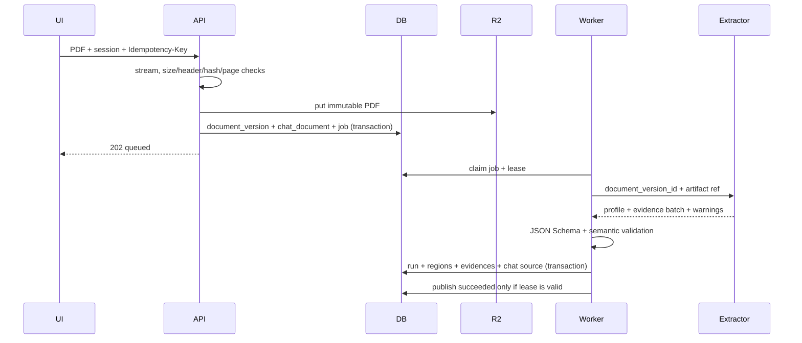
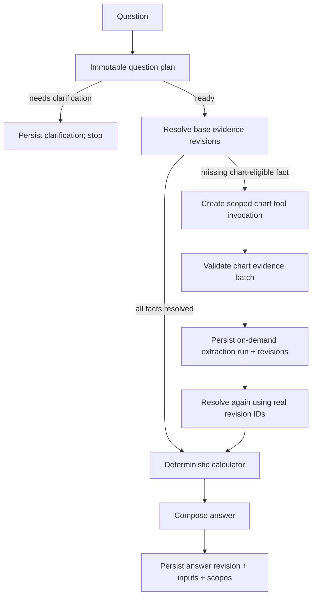

# Thiết kế củng cố data schema và data flow

> Implementation status (2026-11-21): P0.1–P0.5 đã được nối vào runtime. Producer mới luôn phát `value_kind`; validator v2 vẫn đọc payload cũ không có field này và suy ra an toàn theo `source_type` để không phá artifact đã phát hành. Status `unreadable|ambiguous|error`, chart on-demand tạo extraction run/revision PostgreSQL trong transaction, tool invocation có schema/hash helper, và job stale chuyển `superseded` thay vì retry snapshot cũ. Migration smoke test trên database thật vẫn là hạng mục cần chạy khi có kết nối database.

Trạng thái: **Draft để duyệt trước khi triển khai**  
Phạm vi: PDF tiếng Việt có văn bản, bảng, OCR và biểu đồ; hỏi đáp có citation,
phép tính xác định, lịch sử sửa số liệu và tích hợp nhiều tool/provider.  
Tài liệu liên quan: `data-model.md`, `processing-flows.md`,
`HANDOUT/integration-contract.md`, ADR 0001 và ADR 0002.

## 1. Mục tiêu

Thiết kế này phải bảo đảm sáu câu hỏi sau luôn trả lời được bằng dữ liệu đã lưu,
không cần suy đoán từ log hoặc nội dung hiển thị:

1. Tệp nào, phiên bản nào và hash nào đã được xử lý?
2. Tool/provider nào tạo ra từng vùng, từng số và bằng cấu hình nào?
3. Một số là đọc trực tiếp, OCR, đọc từ ô bảng, đọc từ nhãn biểu đồ hay ước
   lượng theo trục?
4. Câu trả lời đã dùng chính xác revision nào của từng số liệu?
5. Nếu job retry, worker mất lease hoặc người dùng sửa số khi job đang chạy,
   dữ liệu nào được phép publish?
6. Khi thay Docling, DePlot hoặc AI provider bằng tool khác, payload nào phải
   được giữ ổn định?

Mục tiêu không phải lưu mọi raw response vào PostgreSQL. Binary, crop, page
image và raw provider output lớn được lưu ở object storage; PostgreSQL chỉ giữ
metadata, hash, quan hệ, trạng thái và revision cần để audit.

## 2. Kết quả audit hiện tại

### 2.1 Vấn đề P0 cần sửa trước

| ID | Hiện trạng | Rủi ro | Thiết kế đích |
|---|---|---|---|
| DD-P0-01 | Contract `document-evidence-v2` cho phép `ambiguous` và `unreadable`, nhưng DB/domain chỉ nhận `valid`, `missing`, `error` | Extraction của bảng/OCR/biểu đồ mơ hồ có thể validate ở adapter nhưng fail khi ghi PostgreSQL | Đồng bộ enum và CHECK constraint xuyên suốt contract → domain → DB |
| DD-P0-02 | Một evidence số có `numeric_value=null` bị runtime suy ra thành `value_kind=text` | Mất nghĩa “đây là số nhưng chưa đọc được”; correction và resolver xử lý sai | `value_kind` phản ánh kiểu mong đợi, không suy ra từ việc value có null hay không |
| DD-P0-03 | Vector chart adapter thiếu một số trường bắt buộc của JSON Schema | Unit test nội bộ có thể xanh nhưng contract consumer khác sẽ reject | Producer phải chạy cả JSON Schema và semantic validator trước publish |
| DD-P0-04 | Chart on-demand chỉ được ghép tạm vào phép tính, chưa persist thành extraction run/revision riêng | `answer_inputs` có ID giả, không audit hoặc recalculate đáng tin cậy | Mỗi chart read được publish như extraction run `on_demand_chart`, sau đó tạo evidence revision thật |
| DD-P0-05 | Runtime dùng logical `document.id` ở một số chỗ thay cho `document_version_id` | Có thể đọc đúng file nhưng ghi provenance sang sai định danh khi tài liệu có nhiều version | Tất cả extraction/question plan/tool call dùng `document_version_id`; `document_id` chỉ là danh tính logic |
| DD-P0-06 | Idempotency response có đường ghi kiểu upsert có thể thay request hash | Cùng idempotency key nhưng payload khác có nguy cơ ghi đè kết quả cũ | Key đã tồn tại phải so request hash; khác hash trả `409 IDEMPOTENCY_KEY_REUSED` |
| DD-P0-07 | Chưa có envelope chung cho tool call | Mỗi adapter tự đặt status/error/version; khó thay provider và khó quan sát retry | Thêm `tool-invocation-v1` chỉ lưu metadata, contract, hash, status và lỗi chuẩn hóa |

### 2.2 Vấn đề P1

- `semantic` trong `document-evidence-v2` dùng `unit` dạng chuỗi, trong khi
  `semantic-v1` mô tả unit có code, label và multiplier. Cần phát hành v3 thay vì
  đổi nghĩa âm thầm của v2.
- Locator bảng chưa mô tả đầy đủ merged cell, header nhiều tầng, row/column span
  và bảng tiếp trang.
- Chưa có document profile bền vững để phân biệt trang native text, scan, mixed,
  blank, rotated hoặc encrypted.
- Raw provider output có thể tồn tại trong artifact nhưng chưa có quy tắc hash,
  retention, redaction và quyền truy cập thống nhất.
- `answer_scopes` chưa được runtime ghi đầy đủ ở mọi nhánh nên tác động của một
  evidence mới xuất hiện sau recalculation chưa được phát hiện hoàn chỉnh.

### 2.3 Vấn đề P2

- Chưa có unit conversion catalog được kiểm duyệt theo thời điểm.
- Chưa có policy cho tài liệu rất lớn, PDF portfolio, attachment, chữ ký số,
  form XFA, biểu đồ dual-axis/log-scale và bảng lồng nhau.
- Chưa có migration tự động từ semantic v2 sang v3; chỉ nên migrate khi có
  fixture thực và báo cáo sai khác.

## 3. Các lớp dữ liệu và nguồn sự thật

```text
PDF/object binary (R2)
        |
        v
document_version + document_profile (PostgreSQL metadata)
        |
        v
tool invocation metadata ----> extraction artifact/crop/raw output (R2)
        |
        v
extraction_run -> source_region -> extracted_evidence (immutable)
        |
        v
chat_source -> chat_evidence -> evidence_revision (chat-local, append-only)
        |
        v
question_plan -> calculation_result -> answer_revision
                                      |-> answer_inputs
                                      `-> answer_scopes
```

Quy tắc nguồn sự thật:

- R2 giữ PDF và artifact lớn theo immutable key có hash.
- PostgreSQL giữ định danh, owner, version, trạng thái, quan hệ và history.
- Redis nếu có chỉ dùng cache, notification hoặc rate limit.
- Frontend state không phải nguồn sự thật và không được tự tạo revision ID.
- Provider output chưa qua validation không phải evidence.

## 4. Định danh, version và hash

| Trường | Quy tắc |
|---|---|
| `document_id` | Danh tính logic của tài liệu, có nhiều version |
| `document_version_id` | Định danh đúng byte PDF đã upload; bắt buộc ở mọi extraction/tool call |
| `extraction_run_id` | Một lần chạy độc lập; base và on-demand chart là các run khác nhau |
| `question_plan_id` | Bất biến; clarification tạo plan mới, không mutate plan cũ |
| `evidence_key` | Ổn định trong một run, không dùng làm PK toàn hệ thống |
| `evidence_revision_id` | UUID thật do persistence tạo; calculator chỉ nhận ID này |
| `answer_revision_id` | Mỗi lần trả lời hoặc tính lại tạo ID mới |
| `trace_id` | Correlation cho một hành động; không thay thế entity ID |
| `sha256` | Hex lowercase 64 ký tự; hash đúng byte, không hash chuỗi đã chuẩn hóa |
| `schema_version` | Số nguyên major; consumer reject major chưa hỗ trợ |

Không dùng tên file, câu hỏi, page text hay storage URL làm khóa. Không dùng ID
dạng `evr:<text>` ở ranh giới persistence.

## 5. Mô hình dữ liệu đích

### 5.1 `document_versions`

Giữ nguyên tính bất biến của PDF và bổ sung profile thông qua artifact riêng.

| Trường | Ý nghĩa |
|---|---|
| `file_hash` | SHA-256 của PDF |
| `content_type` | Media type đã kiểm tra, không chỉ tin header client |
| `byte_size`, `page_count` | Giới hạn upload và lập kế hoạch xử lý |
| `status` | `uploaded → processing → ready/failed`; deleted là lifecycle riêng |
| `storage_key` | Immutable object key; không chứa email hoặc tên người dùng |

Duplicate policy:

- Cùng owner + cùng hash: có thể tái sử dụng binary nhưng vẫn tạo liên kết thư
  viện/session theo yêu cầu.
- Khác owner: không tiết lộ việc hash đã tồn tại.
- Upload cùng tên nhưng khác hash: tạo document version mới, không overwrite.

### 5.2 Document profile

Contract dự kiến `document-profile-v1`:

```json
{
  "schema_version": 1,
  "document_version_id": "uuid",
  "source_sha256": "64-hex",
  "status": "accepted",
  "pdf": {
    "page_count": 12,
    "encrypted": false,
    "has_embedded_files": false,
    "has_javascript": false
  },
  "pages": [
    {
      "page_number": 1,
      "width_points": 595.28,
      "height_points": 841.89,
      "rotation": 0,
      "content_mode": "mixed",
      "ocr_status": "not_required",
      "native_text_sha256": "64-hex"
    }
  ],
  "warnings": []
}
```

`content_mode`: `native_text|scanned|mixed|blank|unsupported`. Profile không
lưu toàn văn; text đầy đủ nằm trong extraction artifact có retention riêng.

### 5.3 `extraction_runs`

Bổ sung các trường sau qua migration mới:

| Trường | Kiểu | Quy tắc |
|---|---|---|
| `contract_name` | text | Ví dụ `document-evidence` |
| `contract_version` | smallint | `> 0` |
| `scope` | text | `base_document|on_demand_chart` |
| `trigger` | jsonb/null | Base phải null; chart phải có plan/fact/region |
| `input_sha256` | text/null | Hash artifact/input đã đưa cho tool |
| `tool_meta` | jsonb | Tên tool, version, provider/model, config hash; không chứa secret/raw prompt |

Một base run completed không được sửa. Retry tạo run mới. On-demand chart run
không được cập nhật status của base run và không được ghi đè base artifact.

### 5.4 `source_regions`

- `bbox` chuẩn hóa top-left `[x0,y0,x1,y1]`, trang bắt đầu từ 1.
- Region có thể là paragraph, table, table_cell, chart, chart_element, image.
- `meta` chỉ giữ locator/provenance nhỏ. Crop hoặc ảnh trang dùng artifact ref.
- Cùng run, `region_key` duy nhất.
- Bbox không có căn cứ thì không tạo evidence dùng cho calculator.

### 5.5 `extracted_evidences`

`data_status` thống nhất:

| Status | Có numeric/text value? | Ý nghĩa |
|---|---|---|
| `valid` | Có đúng một effective value | Có thể bind nếu semantic phù hợp |
| `missing` | Không | Ký hiệu thiếu như `-`, `—`, `N/A`; khác số 0 |
| `unreadable` | Không | Có vùng nguồn nhưng OCR/parser không đọc đáng tin cậy |
| `ambiguous` | Không | Có từ hai cách hiểu hợp lệ trở lên |
| `error` | Không | Lỗi nội bộ/legacy; không dùng làm operand |

`value_kind` mô tả kiểu kỳ vọng. Một ô số OCR không đọc được vẫn là
`value_kind=number`, `numeric_value=null`, `data_status=unreadable`.

### 5.6 Locator bảng

V2 tiếp tục giữ các trường đang có. V3 cần bổ sung:

```json
{
  "table_region_key": "page-2-table-1",
  "row_index": 4,
  "column_index": 3,
  "row_span": 1,
  "column_span": 2,
  "row_header_path": ["Miền Bắc", "Doanh thu"],
  "column_header_path": ["2026", "Quý 1"],
  "continued_from_page": null,
  "is_merged": true
}
```

Header path có thứ tự từ ngoài vào trong. Không nối header bằng chuỗi rồi mất
cấu trúc. Nếu một cell chứa nhiều số mà không xác định được số nào là value,
publish `ambiguous`, không lấy số đầu tiên.

### 5.7 Locator biểu đồ

Mỗi evidence chart phải có:

- `chart_region_key`, category, series;
- `direct_label` kèm bằng chứng `printed_label_verified`; hoặc
- `axis_estimation` kèm trục linear đã review, unit, lower/upper tick và
  assumptions;
- fact/region phải thuộc trigger của question plan;
- DePlot raw value không được trở thành operand nếu chưa có proof ở PDF.

Chart dual-axis, log-scale, stacked/overlaid hoặc không xác định duy nhất
series/category trả `ambiguous` hoặc `unsupported`, không nội suy.

### 5.8 Evidence revision và answer dependency

- Initial revision copy đúng `value_kind`, status và semantic của extracted
  evidence.
- Edit/verify/restore append revision mới; không update row lịch sử.
- `answer_inputs` lưu evidence revision thực tế đã dùng.
- `answer_scopes` lưu toàn bộ source/measure/period/dimension đã tìm, kể cả
  evidence không được chọn.
- Evidence đổi → đánh dấu answer phụ thuộc `needs_update`; recalculation tạo
  answer revision mới.

## 6. Hợp đồng tool call dùng chung

Contract mới `tool-invocation-v1` là envelope, không thay payload nghiệp vụ:

```json
{
  "schema_version": 1,
  "invocation_id": "uuid",
  "trace_id": "opaque-id",
  "tool": {
    "name": "deplot_chart_reader",
    "version": "1.0.0",
    "provider": "huggingface",
    "model": "google/deplot@revision"
  },
  "operation": "read_chart",
  "status": "succeeded",
  "attempt": 1,
  "input": {
    "contract": "chart-read-request",
    "version": 1,
    "payload_sha256": "64-hex",
    "artifact_refs": ["r2://logical-ref"]
  },
  "output": {
    "contract": "document-evidence",
    "version": 2,
    "payload_sha256": "64-hex",
    "artifact_refs": []
  },
  "error": null,
  "timing": {
    "started_at": "2026-01-01T00:00:00Z",
    "finished_at": "2026-01-01T00:00:01Z",
    "latency_ms": 1000
  },
  "warnings": []
}
```

Quy tắc:

- Không lưu API key, authorization header, full prompt hoặc full PDF text.
- `succeeded|partial` cần output; `failed|rejected` cần error.
- Error có `code`, `category`, `retryable`; retry chỉ theo policy của category.
- Tool khác có thể thay thế nếu nhận/trả đúng contract và version.
- Hash payload được tính trên canonical JSON UTF-8, sort key, không whitespace.

Nhóm error chuẩn: `validation`, `unsupported_input`, `timeout`, `rate_limit`,
`provider`, `storage`, `internal`, `cancelled`, `stale_input`.

## 7. Data flow chuẩn

### 7.1 Upload và base extraction



Nếu upload vào R2 thành công nhưng DB transaction thất bại, object được đánh dấu
orphan để cleanup; không trả document thành công. Nếu DB thành công nhưng job
chưa chạy, trạng thái vẫn queued và worker có thể claim sau.

### 7.2 Hỏi đáp và chart on-demand



Chart result không được chỉ ghép in-memory rồi tạo ID giả. Nếu persistence chart
thất bại, calculator không chạy với chart value đó.

### 7.3 Sửa số và recalculation

1. Client gửi `expected_revision_id`, value/status/semantic mới và reason.
2. DB lock `chat_evidence`; khác current revision trả 409.
3. Transaction append revision, đổi pointer, tăng `chat.data_revision`, đánh dấu
   answer phụ thuộc và enqueue recalc.
4. Worker chỉ publish nếu `input_data_revision` vẫn bằng snapshot.
5. Job stale trở thành `superseded`, không phải failed kỹ thuật.

## 8. Edge case theo loại tài liệu

### 8.1 PDF/container

| Trường hợp | Hành vi |
|---|---|
| Sai extension nhưng bytes là PDF | Chấp nhận theo policy media nếu header/parser hợp lệ; tên hiển thị được sanitize |
| Extension PDF nhưng bytes không phải PDF | Reject `INVALID_PDF` trước object publish |
| PDF encrypted cần password | Reject `PDF_ENCRYPTED`; không retry worker |
| PDF hỏng nhưng parser repair được | Profile warning `PDF_REPAIRED`; lưu tool/version đã repair |
| 0 trang hoặc blank toàn bộ | `NO_USABLE_CONTENT`; vẫn có thể giữ tài liệu nhưng không cho chat |
| Trang xoay | Normalize bbox theo rotation; profile giữ rotation gốc |
| Page size rất lớn | Giới hạn render pixel; không tạo ảnh gây OOM |
| Embedded file/JavaScript | Không thực thi; warning và security audit |
| PDF trùng hash | Idempotent theo owner; không upload binary lần hai nếu policy cho phép |
| Worker crash giữa run | Run chưa completed không được attach làm chat source |

### 8.2 Văn bản và OCR

| Trường hợp | Hành vi |
|---|---|
| Native text đầy đủ | Không OCR mặc định |
| Scan không có text | OCR theo page; mỗi token số có bbox/confidence |
| Mixed page | Không tạo duplicate từ native và OCR; OCR chỉ vùng thiếu |
| OCR confidence thấp | `unreadable`, không đưa calculator |
| Ký tự Việt bị mất dấu | Giữ raw text; normalized text chỉ dùng search |
| `1.234` không có locale | `ambiguous`, không tự chọn 1.234 hay 1234 |
| `(123)` | Parse -123 nhưng giữ raw text |
| `-`, `—`, `N/A` | `missing`, không phải 0 |
| Số năm trong câu | Không mặc định coi là measure value |

### 8.3 Bảng

| Trường hợp | Hành vi |
|---|---|
| Merged header | Giữ header path và span |
| Repeated header qua trang | Liên kết `continued_from_page`; không tạo fact duplicate |
| Một ô nhiều số | `ambiguous` trừ khi locator xác định rõ value/footnote |
| Footnote marker sát số | Tách marker nhưng bbox evidence vẫn bao đúng số |
| Bảng lồng nhau | `unsupported` hoặc yêu cầu review; không flatten tùy tiện |
| Unit ở caption | Gắn unit chỉ khi caption/table region có quan hệ không gian rõ |
| Tổng và thành phần cùng hàng | Measure/subject phải phân biệt; resolver không chọn theo vị trí đầu tiên |

### 8.4 Biểu đồ

| Trường hợp | Hành vi |
|---|---|
| Có nhãn số in trên bar/point | `direct_label`, bbox đúng nhãn |
| Không nhãn, trục linear đã review | `axis_estimation`, lưu ticks/assumptions |
| Dual-axis/log-scale | Không nội suy trong P0 |
| Stacked/overlaid | Phải định danh segment/series duy nhất; nếu không thì ambiguous |
| Pie/donut | Chỉ dùng nhãn trực tiếp; không ước lượng góc trong P0 |
| DePlot trả số ngoài trigger | Reject toàn item `CHART_OUT_OF_SCOPE` |
| DePlot trả row width sai | `CHART_OUTPUT_INVALID`; không publish một phần không xác định |
| Provider timeout | Retry giới hạn; không publish batch dở |

## 9. Transaction, concurrency và idempotency

- Không gọi provider hoặc object storage chậm trong DB transaction.
- Publish extraction là một transaction: run + region + evidence + source +
  initial revisions. Run chỉ chuyển completed ở cuối.
- Publish answer là một transaction: answer revision + inputs + scopes + current
  pointer + job success.
- Idempotency key gắn owner + route + request hash. Key tồn tại với hash khác
  luôn trả 409; không upsert thay hash.
- Mỗi worker publish phải kiểm tra job id, lease token, owner và data revision.
- Retry provider có invocation ID mới nhưng cùng parent job và attempt tăng.
- Duplicate chart request cùng plan/region có dedup key; consumer nhận lại run
  đã completed thay vì tạo evidence trùng.

## 10. Bảo mật và retention

- Không log full question context, page text, raw provider response hoặc token.
- `tool_meta` chỉ chứa allow-list field; unknown field bị reject.
- Raw provider output lưu object storage riêng, mặc định retention ngắn hơn PDF.
- Artifact ref phải owner-scoped và được cấp signed URL ngắn hạn.
- Purge document chỉ xóa object khi không còn revision/history được giữ theo
  policy; audit event không chứa nội dung tài liệu.

## 11. Observability

Mỗi stage ghi: `trace_id`, entity IDs, schema name/version, tool name/version,
status, latency, count, error code và payload hash. Không ghi payload đầy đủ.

Event tối thiểu:

```text
DOCUMENT_ACCEPTED
EXTRACTION_JOB_CLAIMED
TOOL_INVOCATION_STARTED
TOOL_INVOCATION_VALIDATED | TOOL_INVOCATION_REJECTED
EXTRACTION_PUBLISHED
QUESTION_PLAN_CREATED
EVIDENCE_RESOLVED
CHART_READ_REQUESTED | CHART_READ_SKIPPED
CALCULATION_SUCCEEDED | CALCULATION_REJECTED
ANSWER_PUBLISHED | ANSWER_SUPERSEDED
```

## 12. Tiêu chí nghiệm thu

1. Fixture `ambiguous/unreadable` validate và persist được mà không biến thành text.
2. Mọi chart operand trong answer có UUID evidence revision tồn tại trong DB.
3. Vector reader và DePlot cùng pass một JSON Schema, không chỉ validator riêng.
4. Chart fact ngoài trigger bị reject trước persistence.
5. Retry cùng idempotency key/hash trả cùng result; khác hash trả 409.
6. Worker mất lease không thể publish run/answer.
7. Sửa evidence trong lúc answer chạy làm job cũ superseded.
8. Bbox vẫn đúng sau zoom/rotation vì DB chỉ lưu normalized source coordinates.
9. Test có fixture native text, scanned, mixed, merged table, ambiguous locale,
   direct label, axis estimate, multi-series và provider timeout.
10. Docs, JSON Schema, migration và contract tests thay đổi trong cùng commit.

## 13. Quyết định chưa chốt

- V3 semantic dùng unit object ngay hay giữ code string và có unit catalog riêng.
- Có lưu raw provider output hay chỉ hash + artifact ref; retention bao lâu.
- PDF repair có được tự động hay yêu cầu người dùng xác nhận.
- Giới hạn render pixel/page và giới hạn tổng OCR time cho demo online.
- Support đầu tiên cho chart ngoài bar/line đơn giản là pie label hay stacked bar.
