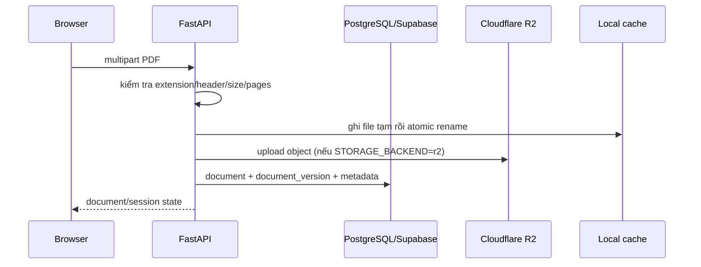

# Audit persistence, xoá dữ liệu và bảo mật runtime

> Trạng thái: **Audit thiết kế và mã nguồn – chưa phải chứng nhận production**  
> Ngày: 2026-11-21  
> Phạm vi: PostgreSQL/Supabase, Cloudflare R2, local cache, authentication, quyền sở hữu dữ liệu và dọn artefact.

## 1. Kết luận điều hành

Hệ thống đã có đường đi gần production: PostgreSQL giữ metadata và revision graph; Cloudflare R2 giữ PDF/extraction artifact khi `STORAGE_BACKEND=r2`; local `runtime/` chỉ nên được xem là cache tạm. Vòng live evidence ở mục 10 đã kiểm chứng ghi–đọc–archive với Supabase/R2 thật; purge vĩnh viễn vẫn chưa có.

### Cập nhật sau khi chạy P0-01/P0-02

Đã chạy một fixture riêng trên runtime thật (email `example.invalid`, PDF mock trong `tests/mock_data`) và đã dọn sạch sau khi kiểm tra:

- `/health` và `/health/ready`: `database.status=ok`, `storage.status=ok`, adapter `postgres_catalog_cloudflare_r2`.
- Đăng ký/đăng nhập → tạo session → upload PDF: thành công.
- Đọc lại file qua API: SHA-256 trước/sau giống nhau (`READ_HASH_MATCH=True`).
- Supabase: document/version tồn tại, `file_hash` trùng file gửi lên.
- R2: `HeadObject` thành công trước archive.
- Archive API trả `storage=soft_deleted`, DB có `deleted_at=true`, nhưng R2 object vẫn tồn tại — xác nhận đúng khoảng trống đã nêu.
- Cleanup fixture: R2 trả 404, DB count của user/document/version đều bằng 0.
- Negative owner-isolation test: user B nhận `404` khi đọc/xoá session của user A; user A vẫn đọc được session của mình (`200`).

Vì vậy **P0-01 và phần persistent round-trip của P0-02 đã có bằng chứng đạt**. Chưa thể đánh dấu purge production đạt vì code vẫn chưa có delete adapter/outbox; object vừa rồi được xoá bằng thao tác cleanup audit có phạm vi cụ thể.

Các điểm phải coi là chưa đạt trước khi bàn giao:

1. **Xoá hiện tại là archive mềm, chưa phải purge.** DELETE session/document chỉ ghi `deleted_at`; object R2 và cache local chưa bị xoá vì adapter chưa có `delete_file`.
2. **Supabase chưa bật RLS trong schema.** Cô lập dữ liệu hiện dựa vào các truy vấn `owner_id` ở backend. Vì vậy tuyệt đối không đưa DSN/DB password/service-role key vào frontend; production cần khóa DB chỉ cho backend và bổ sung RLS hoặc vai trò DB tối thiểu.
3. **Cookie production hiện chưa an toàn tuyệt đối.** `.env` đang có `AUTH_COOKIE_SECURE=false`; giá trị này chỉ phù hợp localhost. Khi chạy HTTPS phải đặt `true`.
4. **Xoá object chưa có protocol bù trừ.** Nếu DB archive thành công nhưng R2 xoá thất bại (hoặc ngược lại) hệ thống hiện không có outbox/delete job để retry và báo cáo trạng thái.
5. **Local runtime đang chứa PDF, JSON trích xuất và log.** Đây không phải rác có thể xoá mù; cần phân biệt dữ liệu người dùng, cache tái tạo được và artefact test.

## 2. Mô hình dữ liệu và nguồn sự thật

| Dữ liệu | Nguồn sự thật hiện tại | Bản sao/cache | Persistent? | Ghi chú |
|---|---|---|---|---|
| User, auth session, project/session, document metadata | PostgreSQL khi `PERSISTENCE_BACKEND=postgres` | Không | Có, sau khi health/round-trip pass | Truy vấn phải owner-scoped |
| Document version, extraction run, evidence, chat, message, answer revision, job, audit event | PostgreSQL | JSON/local adapter chỉ cho offline | Có | Revision/evidence là append-only về mặt nghiệp vụ |
| PDF gốc | R2 khi `STORAGE_BACKEND=r2` | `runtime/uploads` local cache | Có trên R2 nếu upload thành công | Local cache không phải bản chính |
| Extraction JSON | R2 khi bật R2 | `runtime/extractions` local cache | Có trên R2 nếu upload thành công | Có thể tái tạo nhưng phải giữ version/key |
| Render/thumbnail/browser cache | Local/browser | Không | Không đảm bảo | Có thể xoá khi không có process dùng |
| Request/job log | stdout/`runtime/logs`/`tmp/*.log` | Không | Theo retention vận hành | Không chứa secret hoặc full PDF |

### 2.1 Cấu hình đã đọc, không in giá trị bí mật

Runtime hiện được cấu hình theo hướng:

```text
PERSISTENCE_BACKEND=postgres
STORAGE_BACKEND=r2
AUTH_REQUIRED=true
ASYNC_ANSWER_JOBS=true
CHART_READER_BACKEND=deplot
```

`DATABASE_URL`, R2 endpoint, bucket và credentials đã tồn tại trong `.env`; audit không in secret. `/health` và round-trip thật đã chứng minh kết nối hiện tại hoạt động, nhưng không thay thế kiểm tra retry/failure và backup/restore.

`PDF_EXTRACTION_BACKEND` hiện là `legacy` trong runtime đang kiểm tra. Đây là một quyết định triển khai khác với tài liệu Docling; cần chốt lại trước khi tuyên bố pipeline Docling đã chạy production.

## 3. Luồng ghi dữ liệu hiện tại

### 3.1 Upload PDF



Invariant bắt buộc:

- Chỉ commit metadata sau khi file đạt validation và object upload thành công (hoặc có một trạng thái `upload_pending` rõ ràng).
- Không ghi password, API key hay full nội dung PDF vào log.
- Object key phải ổn định, không chứa path người dùng và không cho phép `..`, `/` đầu chuỗi hoặc `\\`.
- `document_version.storage_key` là khóa liên kết để đọc lại artifact; không dùng tên file hiển thị làm định danh.

### 3.2 Extraction và hỏi đáp

Extraction/job/message/answer được ghi vào PostgreSQL. PDF/JSON được đọc từ R2 và chỉ cache về local khi cần. Worker phải lấy job bằng lease/attempt; UI không được coi “đã tạo job” là “đã có câu trả lời”. Trạng thái hiển thị phải phân biệt `queued`, `processing`, `completed`, `failed`, `cancelled`.

## 4. Đánh giá protocol xoá hiện tại

### 4.1 Hành vi đang có

| Thao tác | DB hiện tại | R2 hiện tại | Local cache hiện tại | Đánh giá |
|---|---|---|---|---|
| DELETE session | `deleted_at`/archive chat | Không xoá | Không dọn | Archive mềm, chưa purge |
| DELETE document | `deleted_at`/archive document | Không xoá | Không dọn | Archive mềm, object còn tồn tại |
| Revoke auth session | `revoked_at` | Không liên quan | Cookie hiện tại bị xoá nếu phù hợp | Đúng phạm vi auth |
| Xoá job/message/evidence | Phụ thuộc FK/revision graph | Không liên quan | Không liên quan | Không được hard-delete tuỳ tiện |

Hiện `ObjectStorage` chỉ có `upload_file`, `download_file`, `health`; chưa có `delete_file`. Vì vậy API trả `storage: soft_deleted` là đúng với code hiện tại nhưng **không được gọi là đã xoá dữ liệu hoàn toàn**.

### 4.2 Protocol xoá mục tiêu (P0 cần triển khai)

1. API kiểm tra quyền sở hữu và ghi `deletion_requested_at`, `deletion_requested_by`, `deletion_state=pending` trong cùng transaction với archive.
2. Tạo outbox event/idempotency key cho từng storage key và cache path.
3. Worker xoá R2 theo key, retry exponential backoff; `not found` được coi là thành công idempotent.
4. Xoá local cache sau khi R2 xác nhận hoặc sau grace period được policy cho phép.
5. Chỉ chuyển `deletion_state=completed` khi mọi artifact đã xác minh không còn; thất bại chuyển `failed` và giữ retry/audit.
6. Giữ metadata tối thiểu (audit, owner, thời điểm, lý do) theo retention; không xoá revision đang cần cho pháp lý/audit nếu chưa có policy.
7. UI hiển thị “Đã lưu trữ” và “Đang xoá dữ liệu” khác nhau; không hứa “đã xoá vĩnh viễn” khi worker chưa hoàn tất.

Không hard-delete trực tiếp từ request HTTP vì có thể timeout, mất retry và tạo trạng thái DB/R2 lệch nhau.

## 5. Bảo mật và quyền truy cập

### 5.1 Điểm đang làm đúng

- Cookie session là opaque token, chỉ lưu digest SHA-256 trong DB; cookie HttpOnly và SameSite Lax.
- Password dùng Argon2id nếu có thư viện, scrypt fallback.
- Các repository chính lọc theo `owner_id`; revoke device cũng owner-scoped.
- R2 key được kiểm tra path traversal; download dùng file tạm rồi atomic replace.
- Frontend không được đọc `DATABASE_URL`, R2 secret, OpenRouter key hoặc Supabase service role.

### 5.2 Khoảng trống/rủi ro

| Mức | Rủi ro | Bằng chứng | Cách đóng |
|---|---|---|---|
| P0 | Chưa có RLS/GRANT policy trong schema | Không thấy `ENABLE ROW LEVEL SECURITY`, `CREATE POLICY`, `REVOKE/GRANT` | Dùng DB role runtime tối thiểu; bổ sung RLS theo `owner_id` hoặc giới hạn DB chỉ private backend |
| P0 | Cookie `Secure=false` trong env hiện tại | `AUTH_COOKIE_SECURE=false` | Production HTTPS: `true`; local HTTP mới được `false` |
| P0 | Secret fallback dev | DB/auth IP salt có default dev value trong code | Fail-fast khi `ENVIRONMENT=production` mà thiếu secret mạnh |
| P0 | Không có delete adapter/outbox | ObjectStorage không có delete | Thêm delete + idempotent purge job |
| P1 | CSRF khi request không có Origin được cho qua | `_csrf_guard` | Giữ same-origin check, thêm CSRF token cho browser mutation và test proxy |
| P1 | Rate limit/lockout chưa thể hiện trong auth flow | Chưa có policy rõ trong audit | Thêm rate limit theo IP+account, audit failed login |
| P1 | DB pooler/SSL chưa được chứng minh | Chỉ biết DSN có trong env | Bắt buộc TLS và health probe không in DSN |
| P1 | Object key chưa phân vùng owner | Key dạng UUID dưới `documents/` | Thêm prefix tenant/user ở version mới; không đổi key cũ không có migration |
| P2 | Log/cache có thể chứa dữ liệu nhạy cảm | `runtime/logs`, JSON extraction | Redaction, retention, permission và cleanup job |

### 5.3 Quy tắc secret

- `.env` chỉ ở server, không commit; `.env.example` không chứa secret thật.
- Rotate ngay mọi key đã từng xuất hiện trong screenshot/log/chat công khai.
- R2 token chỉ có quyền bucket cần dùng (`GetObject`, `PutObject`, sau này `DeleteObject`), không cấp account-wide.
- Frontend chỉ nhận session cookie hoặc access capability ngắn hạn; không nhận DB/R2 credential.

## 6. Kiểm chứng persistent thật (không xoá dữ liệu người dùng)

Phần hướng dẫn dưới đây là runbook tái lập live probe; lần chạy 2026-11-21 đã thực hiện bằng user/test prefix riêng.

### 6.1 Readiness

```powershell
curl.exe -sS http://127.0.0.1:8000/health
curl.exe -sS http://127.0.0.1:8000/health/ready
```

Pass khi response cho biết `database.status=ok`, `storage.status=ok`, adapter là `postgres`/`r2`, không có secret trong body/log.

### 6.2 Round-trip bắt buộc

1. Tạo session test và upload một PDF nhỏ có marker không nhạy cảm, ví dụ `AUDIT-RUN-<RUN_ID>`.
2. Ghi lại `session_id`, `document_id`, `version_id`, `storage_key`, `trace_id`.
3. Query Supabase bằng DB role backend, dùng placeholder:

```sql
SELECT id, owner_id, deleted_at, created_at
FROM documents WHERE id = :document_id;

SELECT id, document_id, storage_key, created_at
FROM document_versions WHERE document_id = :document_id;
```

4. Đọc lại PDF qua API sau khi restart backend; nếu R2 là source of truth thì kết quả không phụ thuộc `runtime/uploads`.
5. Kiểm tra object bằng R2/S3 `HeadObject` với đúng `storage_key`, không list toàn bucket trong log.
6. Chạy extraction, reload API/worker, xác minh extraction run/job/message vẫn tồn tại.
7. Archive test document; xác minh list thường không còn trả document, DB có `deleted_at`, R2 object **vẫn còn theo hành vi hiện tại**. Đây là bằng chứng để không nhầm archive với purge.
8. Chỉ sau khi có purge implementation mới kiểm tra `HeadObject=404`, local cache không còn và `deletion_state=completed`.

### 6.3 Chống mất dữ liệu và retry

- Upload cùng idempotency key hai lần không tạo hai document version.
- Worker restart giữa DB commit và R2 upload phải để lại trạng thái retry được.
- R2 timeout không làm API báo “đã lưu” nếu chưa có xác nhận.
- Hai request archive đồng thời phải idempotent, không tạo hai purge job.

## 7. Kiểm kê thư mục và quyết định dọn dẹp

### 7.1 Giữ lại

| Thư mục | Lý do |
|---|---|
| `apps/`, `services/`, `contracts/`, `scripts/`, `tests/` | Source và test chính |
| `docs/`, `design-system/`, `infra/` | Tài liệu, UI system, deployment/config |
| `.venv/` | Môi trường Python; có thể tái tạo nhưng không phải rác runtime |
| `.codex/`, `AGENTS.md`, `opencode.json` | Tooling/workspace instruction; không xoá trong cleanup dữ liệu |
| `runtime/` | Có PDF, extraction, session metadata; phải phân loại/backup trước |

### 7.2 Ứng viên artefact tạm (chỉ dọn sau khi dừng process)

`tmp/` hiện chứa log, screenshot, Chrome profile và pytest temp directory. Đây là vùng có thể dọn có kiểm soát. `.pytest_cache` và các cache tương tự có thể tái tạo nhưng nên dọn bằng lệnh rõ mục tiêu, không xoá source.

### 7.3 Quy trình cleanup an toàn

1. Kiểm tra process đang dùng backend/frontend/worker và file lock.
2. Xuất manifest `path,size,last_write_time,sha256` cho vùng định xoá.
3. Không đụng `runtime/uploads`, `runtime/extractions`, `runtime/sessions.json` nếu chưa xác nhận đó là test data.
4. Chỉ chuyển `tmp/` artefact đã xác định sang quarantine hoặc xoá sau khi có bản manifest.
5. Ghi lại cleanup event; không xoá log audit trước retention.

**Chưa thực hiện xoá trong audit này.** Lý do: `runtime/` có PDF và JSON thật, còn `tmp/` có thể thuộc process đang chạy.

## 8. Tiêu chí nghiệm thu bảo mật/persistence

- [ ] `/health/ready` pass liên tục sau restart với PostgreSQL pooler và R2.
- [ ] Upload–read–restart–read trả lại đúng byte hash của PDF.
- [ ] Metadata, extraction, message, answer revision tồn tại trong Supabase sau restart.
- [ ] Mọi truy vấn user-facing đều owner-scoped; test user A không đọc/sửa/xoá được dữ liệu user B.
- [ ] DB không public trực tiếp; frontend không chứa secret.
- [ ] `AUTH_COOKIE_SECURE=true` trên HTTPS; secret fallback bị fail-fast ở production.
- [ ] Archive và purge có trạng thái riêng, idempotency key, retry và audit event.
- [ ] Purge thành công mới xác nhận object R2/cache đã biến mất.
- [ ] Cleanup chỉ xoá artefact đã phân loại, không xoá PDF người dùng.

## 9. Quyết định cần chốt trước khi triển khai code

1. Có cho phép giữ archive mềm bao lâu (ví dụ 30 ngày) trước purge không?
2. Có yêu cầu RLS trên Supabase, hay DB chỉ private và chỉ backend được truy cập?
3. Bucket R2 có bật versioning/object lock/lifecycle rule không?
4. `runtime/` là cache thuần hay được coi là fallback khi R2 down? Nếu fallback, cần quy định mã hoá và retention.
5. Có được phép dọn `tmp/` sau khi dừng toàn bộ process không?
 
## 10. Live evidence bổ sung (2026-11-21)

Migration `0007_data_contract_hardening` đã được apply trên Supabase. `/health` và `/health/ready` đều báo PostgreSQL/R2 `ok`; OpenRouter smoke với `openai/gpt-6-luna` trả structured request có citation. Sau khi cài extra `docling-deplot`, PDF smoke đã chạy thật bằng Docling trên `syn-report-001.pdf` (3 trang, 18 evidence, 0 cảnh báo, provider `docling`). DePlot đã tải weights `google/deplot` và suy luận biểu đồ mẫu thành bảng dữ liệu.

Worker process riêng đã chạy với job extraction và answer async. Event đã quan sát: `queued → claimed → progress → retry_scheduled → failed (lease expired) → retry_requested → claimed → succeeded`; placeholder assistant chuyển `completed` và `answer_revision` được lưu trong PostgreSQL. Runner đã được sửa để đọc `SOURCELENS_WORKER_ID` thay vì bỏ qua identity launcher.

Owner isolation live đã pass (user B đọc/xóa tài nguyên A nhận `404`). Archive hiện vẫn là soft-delete; chưa có `ObjectStorage.delete_file`/outbox purge nên không gọi là xóa vĩnh viễn. Không hard-delete revision/evidence bằng cách tắt trigger append-only.

Các điều kiện còn thiếu để gọi production thật: chốt RLS hoặc private DB role, purge worker idempotent, crash/restore test tự động, rate-limit auth và supervisor/container cho worker. Docling/DePlot đã có live smoke; cần benchmark cold-start/CPU và đặt giới hạn tài nguyên trước khi bật tải lớn.
